# Skill Eval Lite

New here? Open `starting.html` first: a guided tour with a worked example.

Skill Eval Lite tests whether one change to an AI assistant makes its work
better. You describe the experiment in one file, `experiment.toml`: the
assistant's parts, the rounds (the assistant as it is, a change, and two
controls), the prompts with reference outputs, the checks and a judging
prompt. The runner, `run_ab.py`, runs every round on every prompt with
Claude Code, each run in a fresh copy of the assistant with nothing of yours
loaded, and keeps every output, record and trace. The wizard, `wizard.html`,
loads the runs, shows you blind pairs to judge, and reports the results,
including whether each check, the LLM judge and the people moved when they
should have.

For Personal I there is a checks-only mode: suites of mechanical, LLM and
human tests run on every case of a product and a process, with control
cases, and reported together (see "Personal I: suites").

You don't have to write either file by hand. The wizard's two designers make
them on screen, one question at a time, with a picture and an example on
each screen: the experiment designer (Shared I) and the suite designer
(Personal I). See "Make the file on screen".

It was made for AI 5500 (Vanderbilt, Fall 2026), for Shared I and Personal I. The class
assistant is Wren, the AI 5100 assistant template's fictional example: Wren
works for Morgan Reyes, and nobody in it is real.

Version 0.1.0 (the version is in `VERSION`).

## Getting started, in pictures

Skill Eval Lite has two parts. You type commands in a *terminal*: a window
where you type a command and press Enter to run it. Then you freeze, judge
and read the results in the *wizard*, `wizard.html`, a page in your web
browser. The wizard opens on a *Getting started* screen with every step of
every path: what to type or click, a picture of it, what you should see, and
what to do if you don't. It fills in your own folder names, and has a Copy
button for each command.

**Stuck?** In the terminal, in the `skill-eval-lite` folder, type
`python3 run_ab.py status` to see where you are and the next command to
type. Or type `python3 run_ab.py ask`: Claude Code (or Codex) opens, looks at
your files, and helps you step by step.

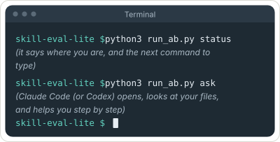

### Which path are you on?

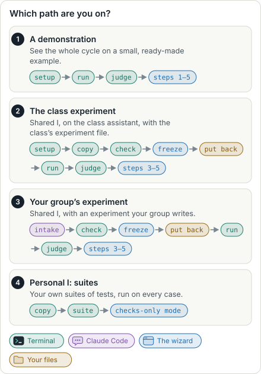

Each path has a picture of its order: which steps happen in the terminal and
which in the wizard.

- [A demonstration](docs/diagrams/order-demo.svg): see the whole cycle once,
  on a small example. Start here if you are new.
- [The class experiment](docs/diagrams/order-class.svg): Shared I, on the
  class assistant, with the course's experiment file.
- [Your group's experiment](docs/diagrams/order-group.svg): Shared I, with an
  experiment your group writes. Its steps are below.
- [Personal I: suites](docs/diagrams/order-suites.svg): your own suites of
  tests, in the wizard's checks-only mode.

### The order of a real experiment

The order is not obvious, so here it is. Claude Code's intake skill writes
the experiment file. `check` checks it. Then the wizard *freezes* it.
Freezing writes your experiment down, with the date and a fingerprint,
before you see any results, so that nobody can change the test to fit the
results later. The runner uses the frozen file, so you export it from the
wizard and put it back in its folder before you `run` and `judge`. Then the
wizard again, for judging and the results. A demonstration is shorter: its
file is a small example, so it is run first and frozen afterwards.

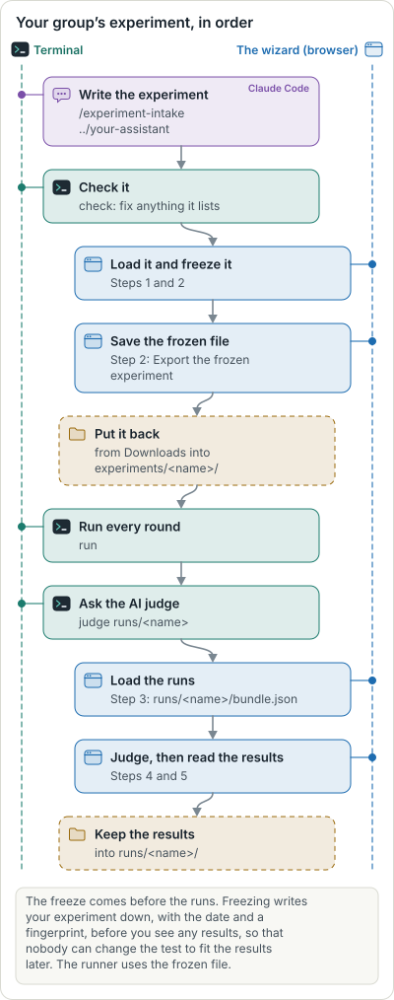 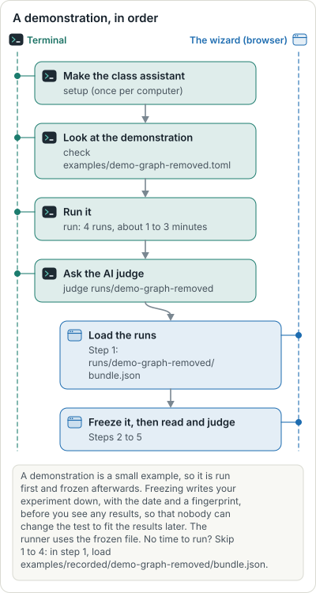

### Do I need to run the intake skill first?

Only for your group's own experiment. The *intake skill* is a set of
instructions that lets Claude Code write your experiment file with your
group. Start Claude Code in this folder (`claude`) and type
`/experiment-intake ../your-assistant`. With Codex, type `codex` and ask it
to follow `AGENTS.md`. Your assistant's folder must be a git project with a
`CLAUDE.md` (the assistant's main instructions). If it isn't, the intake
explains what is needed and, only if you say yes, makes the folder a git
project with a first commit. It never writes your assistant's instructions.

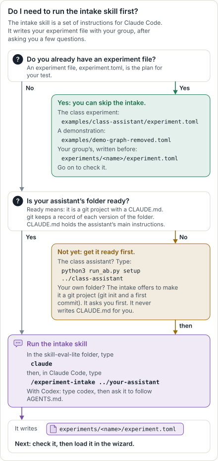

Or make the file on screen instead, with the wizard's experiment designer:
see "Make the file on screen".

### Where everything is

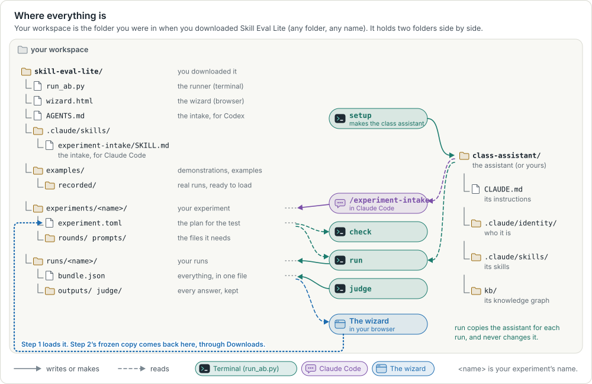

### Meet the class assistant

Wren is the class assistant. Wren works for Morgan Reyes. Both are made up:
they are the fictional example in the AI 5100 assistant template. Wren
drafts Morgan's replies, summaries and briefs, which Morgan sends under
Morgan's own name. Wren is a folder of files, and each file is a part that an
experiment can change.

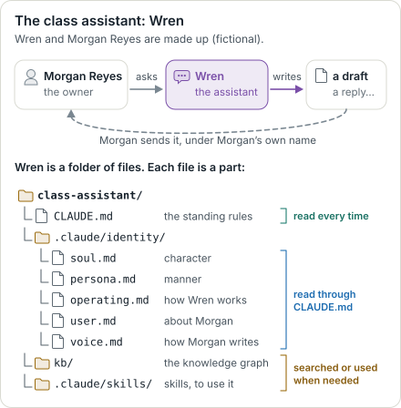

### One step at a time

<b>First time on this computer</b>: seven steps, once.

<!-- steps:first:begin (written by dev/diagrams.mjs from the wizard's steps; edit them in wizard.html) -->

1. **Open a terminal.** *In the terminal.* A *terminal* is a window where you type commands. You type one, press Enter, and it runs.

   On a Mac: Press Command and Space, type Terminal, and press Return. On Windows: Press the Windows key, type PowerShell, and press Enter. On Linux: Press Ctrl, Alt and T together.

   You should see: A window with a line that ends in `$`, `%` or `>`, and a blinking cursor.

   If not: Ask a classmate or the instructor to show you once. It takes a minute.

   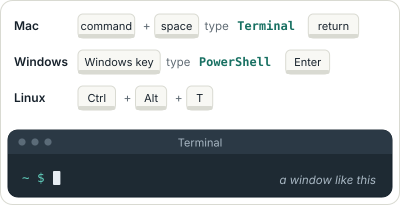

2. **Install Claude Code.** *In the terminal.* *Claude Code* is an AI assistant, made by Anthropic, that works in the terminal. The runner uses it to run your assistant. Copy the line, paste it into the terminal, and press Enter.

   Type this, then press Enter:

       curl -fsSL https://claude.ai/install.sh | bash

   On Windows (PowerShell):

       irm https://claude.ai/install.ps1 | iex

   You should see: A message saying that Claude Code is installed.

   If not: Close the terminal, open a new one, and try again. The full guide is at code.claude.com/docs/en/setup.

   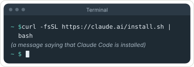

3. **Log in to Claude Code, once.** *In the terminal.* This starts Claude Code for the first time. Your web browser opens: log in with your Claude account. Then come back to the terminal, type `/exit` and press Enter.

   Type this, then press Enter:

       claude

   You should see: Claude Code’s welcome. After `/exit`, the terminal’s prompt again.

   If not: No browser page? Copy the web address that Claude Code shows into your browser.

   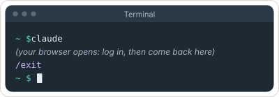

4. **Download Skill Eval Lite.** *In the terminal.* *git* is a tool that keeps a record of every version of a folder. To *clone* is to download a copy of a project with git. This makes a folder called `skill-eval-lite`.

   Type this, then press Enter:

       git clone https://github.com/vanderbilt-ms-ai/skill-eval-lite

   You should see: `Cloning into 'skill-eval-lite'...`

   If not: `git: command not found`? Install git from git-scm.com, open a new terminal, and try again.

   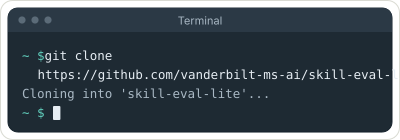

5. **Go into the folder.** *In the terminal.* `cd` means “change folder”. Type every command after this one in the `skill-eval-lite` folder.

   Type this, then press Enter:

       cd skill-eval-lite

   You should see: The prompt now shows `skill-eval-lite`.

   If not: `No such file or directory`? The download didn’t finish. Do the step before again.

   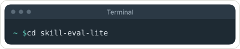

6. **Check your setup.** *In the terminal.* `doctor` checks Python, git, Claude Code and your login. It makes one tiny test run, a few seconds long. (On Windows, type `py` where you see `python3`.)

   Type this, then press Enter:

       python3 run_ab.py doctor

   You should see: Every line starts with `ok`.

   If not: A line starts with `FIX`? It says what to do. If it says you are not logged in, do “Log in to Claude Code” again.

   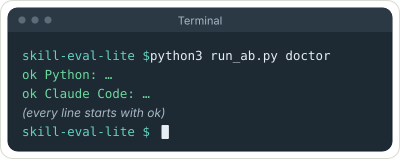

7. **Open the wizard.** *In the wizard.* The *wizard* is this page. It opens in your web browser. You can also double-click `wizard.html` in the `skill-eval-lite` folder.

   Type this, then press Enter:

       open wizard.html

   On Linux:

       xdg-open wizard.html

   On Windows (PowerShell):

       start wizard.html

   You should see: This page, in your browser.

   If not: Nothing opens? Double-click `wizard.html` in the `skill-eval-lite` folder instead.

   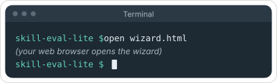

<!-- steps:first:end -->

<b>Your group's experiment</b>: every step, from the intake to the results.

<!-- steps:group:begin (written by dev/diagrams.mjs from the wizard's steps; edit them in wizard.html) -->

1. **Make the class assistant, if you use it.** *In the terminal.* This makes Wren, the class assistant, in a new folder called `class-assistant`, next to `skill-eval-lite`. (`../` means “next to this folder”.) You only do this once. Using your own assistant instead? Put its folder next to `skill-eval-lite`, and skip this step.

   Type this, then press Enter:

       python3 run_ab.py setup ../class-assistant

   You should see: `The class assistant is ready in ../class-assistant`

   If not: If it says the folder `already exists and is not empty`, you made it before. Go on to the next step.

   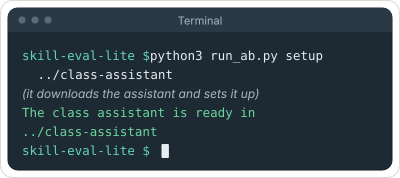

2. **Start Claude Code.** *In the terminal.* Type it in the `skill-eval-lite` folder, so that Claude Code finds the intake skill. The *intake skill* is a set of instructions that lets Claude Code write your experiment file with you.

   Type this, then press Enter:

       claude

   You should see: Claude Code’s welcome, and a box to type in.

   If not: `command not found`? Do “Install Claude Code” (First time on this computer) again.

   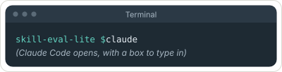

3. **Start the intake.** *In Claude Code.* Type this into Claude Code’s box and press Enter. It reads your assistant’s files, then asks your group up to five questions, one at a time. Using Codex instead? Type `codex` in the terminal, then: “Please follow AGENTS.md to write an experiment intake for ../your-assistant.”

   Type this in Claude Code, then press Enter:

       /experiment-intake ../your-assistant

   You should see: A list of the assistant’s parts, then a first question.

   If not: It doesn’t know the command? You started `claude` in another folder. Type `/exit`, then `cd skill-eval-lite`, and start again.

   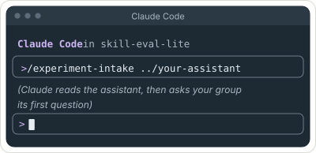

4. **Answer its questions, together.** *In Claude Code.* Answer in your own words. It suggests the versions to compare, the requests and the checks: correct anything that is wrong. At the end it writes `experiments/<name>/experiment.toml`. Note the name it gives: it is *&lt;name&gt;* in the steps below.

   You should see: “I wrote experiments/…/experiment.toml” and a checklist.

   If not: Stuck on a question? Ask it to explain, or say “please suggest an answer”.

   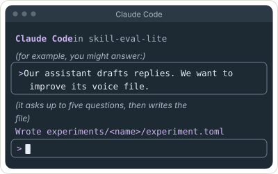

5. **Leave Claude Code.** *In Claude Code.* Type `/exit` and press Enter. You are back in the terminal, in the `skill-eval-lite` folder.

   Type this in Claude Code, then press Enter:

       /exit

   You should see: The terminal’s prompt again.

   If not: Still in Claude Code? Press Ctrl and C twice.

   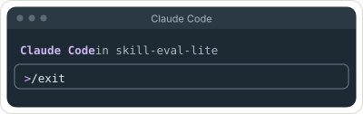

6. **Check it.** *In the terminal.* `check` reads the experiment file and lists anything missing or wrong.

   Type this, then press Enter:

       python3 run_ab.py check experiments/<name>/experiment.toml

   You should see: `Nothing is missing.` and `Frozen: not yet`.

   If not: Lines that start with `must fix`? Start `claude` again and ask: “Please fix the errors that check lists.”

   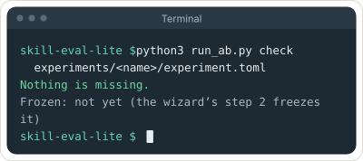

7. **Load your experiment file into the wizard.** *In the wizard.* Open the wizard (this page) and press *Go to step 1* below. In the window that opens, pick your experiment file.

   Click: In step 1, under “Your experiment file”, click *choose a file*.

   You should see: A summary of your experiment, and “Nothing is missing.” in green.

   If not: Something listed in red? Fix it in the file (or ask Claude Code to), then load it again.

   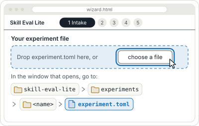

8. **Freeze it.** *In the wizard.* *Freezing* writes your experiment down, with the date and a fingerprint, before you see any results, so that nobody can change the test to fit the results later. The runner uses the frozen file.

   Click: In step 2, read the list, then click *Freeze*.

   You should see: “The record”, with the date and a fingerprint.

   If not: Is *Freeze* grey? An item on the list is not met. Fix it in the file, load it again in step 1, and come back.

   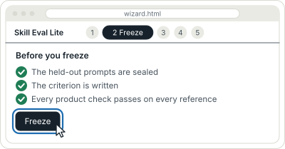

9. **Save the frozen file.** *In the wizard.* The frozen file is your experiment file with the freeze written at the end. The runner must run this one.

   Click: Still in step 2, click *Export the frozen experiment*.

   You should see: Your browser saves `experiment.toml` in your Downloads folder.

   If not: If it is saved as `experiment (1).toml`, an older one was there. Use the newest one, and rename it `experiment.toml`.

   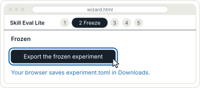

10. **Put the frozen file back in its folder.** *In your files.* Move `experiment.toml` from Downloads into `skill-eval-lite`, then `experiments`, then `<name>`. Replace the old one. Drag it in Finder or File Explorer, or type this in the terminal:

       mv ~/Downloads/experiment.toml experiments/<name>/experiment.toml

   On Windows (PowerShell):

       Move-Item -Force ~/Downloads/experiment.toml experiments/<name>/experiment.toml

   You should see: Nothing in the terminal. No message means it worked.

   If not: `No such file`? Look in Downloads for the newest `experiment` file, and check its name.

   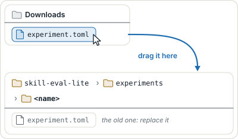

11. **Check that it is frozen.** *In the terminal.* The same check as before. Now it should also say the file is frozen.

   Type this, then press Enter:

       python3 run_ab.py check experiments/<name>/experiment.toml

   You should see: `Frozen: yes`, with today’s date.

   If not: `Frozen: not yet`? The old file is still there. Do the step before again.

   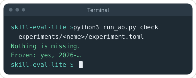

12. **Run every round.** *In the terminal.* Every version of the assistant gets every request, twice. With 4 versions and 4 requests, that is 32 runs, 4 at a time: about 5 to 15 minutes.

   Type this, then press Enter:

       python3 run_ab.py run experiments/<name>/experiment.toml --assistant ../your-assistant --jobs 4

   You should see: A line for each run, then `The bundle for the wizard: runs/<name>/bundle.json`

   If not: A run that failed is kept as a failure; that is all right. Stopped? Run the same command again: finished runs are not run twice.

   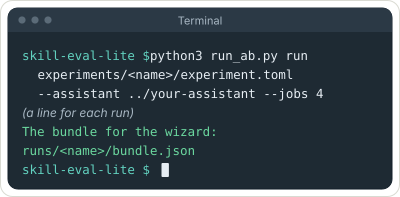

13. **Ask the AI judge.** *In the terminal.* The *AI judge* is a language model that compares two answers to the same request. It doesn’t know which version wrote which. Your own judgments come later, in the wizard.

   Type this, then press Enter:

       python3 run_ab.py judge runs/<name>

   You should see: `The judge’s verdicts are in runs/<name>/bundle.json`

   If not: `There is no bundle.json`? The runs didn’t finish. Run the step before again: finished runs are not run twice.

   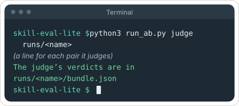

14. **Load the runs.** *In the wizard.* A *bundle* is one file, `bundle.json`, that holds everything from the runs: the plan and every answer. Pick it in the window that opens.

   Click: In step 3, under “Your runs”, click *choose a file*.

   You should see: Under “Coverage”, a green “ok” for each run.

   If not: Can’t find the file? It is in the `skill-eval-lite` folder, then `runs`, then `<name>`.

   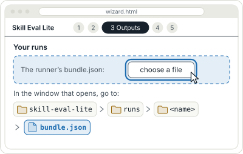

15. **Start judging.** *In the wizard.* Each of you judges alone, under your own initials. Please don’t compare notes until you have all finished.

   Click: In step 4, type your initials and click *Start*.

   You should see: Two answers side by side, called Left and Right.

   If not: Step 4 is grey? Load the runs first (step 3).

   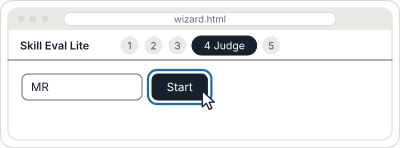

16. **Judge each pair.** *In the wizard.* Read both answers against the question in blue. You can’t see which version wrote which until you record your choice.

   Click: Choose *Left is better*, *About the same* or *Right is better*. Write one line saying why. Click *Record*.

   You should see: After each one, which version wrote each side. Then *Next pair →*.

   If not: *Record* is grey? Choose one of the three, and write your reason.

   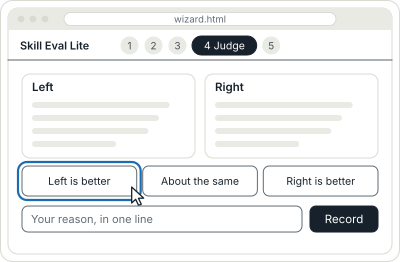

17. **Read the results, and save them.** *In the wizard.* Step 5 shows how often you preferred the new version, and whether the controls moved as they should. Send `judgments.csv` to your teammates, and import theirs here.

   Click: In step 5, click *Export judgments.csv*, then *Export results.json*.

   You should see: Two files in your Downloads folder.

   If not: The buttons are grey? Judge at least one pair in step 4.

   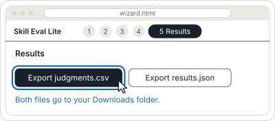

18. **Keep the results with the runs.** *In your files.* Move `judgments.csv` and `results.json` from Downloads into `skill-eval-lite`, then `runs`, then `<name>`. Drag them, or type this:

       mv ~/Downloads/judgments.csv ~/Downloads/results.json runs/<name>/

   On Windows (PowerShell):

       Move-Item -Force ~/Downloads/judgments.csv, ~/Downloads/results.json runs/<name>/

   You should see: Nothing in the terminal. No message means it worked.

   If not: A name ends in (1)? Use the newest file, and rename it.

   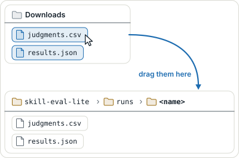

<!-- steps:group:end -->

The other paths' steps, each with its picture, are on the wizard's Getting
started screen, and in `docs/diagrams/steps/`.

## What you need

- Python 3.11 or later (`python3 --version`; on Windows, `py --version`).
- git.
- A web browser.
- Claude Code, with a paid Claude plan that includes it. No API key is
  needed: Claude Code uses your plan's login, and each run is one Claude
  Code session on your plan. The dollar amounts the runner prints are
  Claude Code's own estimates; on a plan they count toward its usage
  limits rather than being billed. (If `ANTHROPIC_API_KEY` is set, Claude
  Code uses the key instead and the runs are billed to it; `doctor` says
  which login is in use, and `unset ANTHROPIC_API_KEY` returns you to your
  plan.) To install it
  (https://code.claude.com/docs/en/setup):

      curl -fsSL https://claude.ai/install.sh | bash      # macOS, Linux
      irm https://claude.ai/install.ps1 | iex             # Windows PowerShell

- Or Codex instead of Claude Code, with a paid ChatGPT plan that includes it
  (https://developers.openai.com/codex/cli). No API key is needed: run
  `codex login` once and sign in with your ChatGPT account. Add
  `--runner codex` to `doctor`, `run`, `judge` and `suite` (see "With
  Codex" below). If `OPENAI_API_KEY` is set, runs leave it out and use your
  plan; `--use-api-key` uses the key instead, billed to it.

Nothing else: the runner uses Python's standard library, and the wizard is
one HTML file that works offline.

## Walkthrough

On Windows, type `py` where these steps say `python3`.

1. **Get Skill Eval Lite.**

       git clone https://github.com/vanderbilt-ms-ai/skill-eval-lite
       cd skill-eval-lite

2. **Log in to Claude Code once, and check your setup.** If you have never
   used Claude Code on this computer, run `claude`, log in when it asks,
   and type `/exit`. Then:

       python3 run_ab.py doctor

   It checks Python, git, Claude Code and your login, and makes one tiny
   run (a few seconds, well under a cent) to show that your own settings,
   memory, plugins, MCP servers and connectors stay out of a run. Every
   line should say `ok`.

3. **Set up the class assistant.**

       python3 run_ab.py setup ../class-assistant

   This clones the AI 5100 assistant template from GitHub at a pinned
   commit, puts its fictional example in place with the class's knowledge
   graph pages, and commits the result on a branch, `class-assistant`. To
   use another assistant instead, give its folder (any git project with a
   `CLAUDE.md`) wherever these steps say `../class-assistant`.

4. **Look at the experiment.** Open `examples/demo-one-line.toml` in an
   editor: round A is Wren as it is, round B adds one line to Wren's voice
   file, and the three prompts ask for short replies (to Sam, Ms. Okafor and
   Priya). The line is in
   `examples/class-assistant/rounds/one-line/.claude/identity/voice.md`,
   under "House rule": "Keep every reply under 40 words." Change it to a
   line of your own if you like: that is round B. Then:

       python3 run_ab.py check examples/demo-one-line.toml
       python3 run_ab.py plan examples/demo-one-line.toml --jobs 6

5. **Run it.**

       python3 run_ab.py run examples/demo-one-line.toml --assistant ../class-assistant --jobs 6

   Six runs, six at a time: about half a minute. The runs are kept in
   `runs/demo-one-line/`, failures included. To run it again with another
   line, add `--again` (finished runs are otherwise not run twice), and add
   `--again` to `judge` too: otherwise it keeps the verdicts on the earlier
   outputs and says every pair is already judged.

6. **Run the LLM judge** on the blind pairs.

       python3 run_ab.py judge runs/demo-one-line

7. **Open the wizard.** Double-click `wizard.html`, or:

       open wizard.html          # macOS
       xdg-open wizard.html      # Linux
       start wizard.html         # Windows

8. **Step 1, Intake:** drop `runs/demo-one-line/bundle.json` on "A run
   you have made" (or choose it). The wizard reads the experiment from it
   and summarizes it.

9. **Step 2, Freeze:** read the checklist and press *Freeze this
   demonstration*. (A full experiment passes every item and gets *Freeze*.)

10. **Step 3, Outputs:** every prompt, round and repeat has a cell. Open one
    to read the output, the assistant's route and its checks.

11. **Step 4, Judge:** type your initials and press *Start*. For each pair,
    choose *Left is better*, *About the same* or *Right is better*, give a
    one-line reason and press *Record*. Which round wrote which side is
    shown only after you record. *Fast judging*, a box under your initials,
    is for a quick pass or a room voting together: one click records, the
    reason is optional, and *Skip →* leaves a pair for later (the numbered
    dots go back to it). Keys: L, S and R record; → skips, or goes on.

12. **Step 5, Results:** the share of judgments that preferred the newer
    round, with its 95% interval; then *Did the evaluation move when it
    should?*, which compares each source (people, the LLM judge, each check)
    with the round's prediction.

13. **Export:** *Export judgments.csv*, *Export results.json* and *Export the
    frozen experiment*. Import a teammate's `judgments.csv` in step 5 to
    combine your judgments.

The other demonstrations run the same way, or load their recorded runs in
step 1 without running anything:

| Demonstration | Rounds | What should happen | Recorded run |
| --- | --- | --- | --- |
| `examples/demo-one-line.toml` | A, B (one line added to the voice file) | what the line predicts; for "under 40 words", shorter replies | `examples/recorded/demo-one-line/bundle.json` |
| `examples/demo-graph-removed.toml` | A, C (graph removed) | C gets worse | `examples/recorded/demo-graph-removed/bundle.json` |
| `examples/demo-voice-reordered.toml` | A, D (voice file reordered) | nothing moves | `examples/recorded/demo-voice-reordered/bundle.json` |
| `examples/demo-board-memo.toml` | A, B (board memo section written) | B's board drafts get better | `examples/recorded/demo-board-memo/bundle.json` |

The wizard also has *Use the class assistant's intake* (step 1) and, for
that intake, made-up practice outputs (step 3), labelled as made up.

## With Codex

If your paid plan is for Codex (ChatGPT's coding agent) rather than Claude
Code, every step above works the same with `--runner codex` added:

    python3 run_ab.py doctor --runner codex
    python3 run_ab.py run examples/demo-graph-removed.toml --assistant ../class-assistant --runner codex --jobs 4
    python3 run_ab.py judge runs/demo-graph-removed-codex

The runs go in `runs/<experiment>-codex/`, and `judge` uses Codex for a
folder of Codex runs. A real Codex run of the first demonstration, with its
judge, is in `examples/recorded/demo-graph-removed-codex/bundle.json`.

**A Codex run evaluates the assistant's instructions as Codex reads them.**
The class assistant is a Claude Code assistant: `CLAUDE.md`, which imports
the files in `.claude/identity/` with `@` lines, and skills in
`.claude/skills/`. Codex reads neither. For each run, in the run's fresh
copy only, the runner writes `AGENTS.md` (the file Codex reads) from
`CLAUDE.md` with every `@` import replaced by the imported file's text, and
copies each `.claude/skills/<name>/` to `.agents/skills/<name>/`, where Codex
finds skills (it lists them by name and description and reads one when it
chooses, as Claude Code does). The assistant's own files are not changed.
Each run's `run.json` records this under `codex_mapping`, with what was not
mapped (Claude Code settings and slash commands). So Codex results and
Claude Code results are not interchangeable: run every round of one
comparison with the same runner. The runner refuses to add Codex runs to a
folder of Claude Code runs, and `judge` refuses a folder that mixes them.

In the experiment file, `[model]` can say `runner = "codex"` and name a
Codex model (`model = "gpt-6.1-sol"`, the default); with `--runner codex`
on a file written for Claude Code, a Claude model name is replaced by
Codex's default, or by `[model].codex_model`. `reasoning_effort` (for
example `"low"`) is passed to Codex. Codex has no cost cap: the time limit
is the only limit, and it reports tokens rather than dollars. On a ChatGPT
plan they count toward the plan's usage limits.

Codex's tools differ from Claude Code's: it reads files with shell commands
(`cat`, `rg`) and edits them with its own patch tool. So that the same
checks read both runners' traces, a single read-only command is named in
the trace as the tool Claude Code would have used (`Read`, `Glob`, `Grep`;
reading a skill's `SKILL.md` is `Skill`), with the command kept as its
detail; a file Codex writes is `Write` or `Edit`; anything else is `Bash`.
Codex has no per-command allow list like `Bash kb/kb *`: its sandbox
confines every command instead (SAFETY.md, "Codex").

## Your own experiment

The full class experiment is `examples/class-assistant/experiment.toml`, with
its round files under `rounds/` and its prompts' starting files under
`prompts/`. It has four rounds (A as it is; B, the voice file's missing
board memo section; C, the graph removed; D, the voice file reordered), four
development prompts and two held out, and two repeats: 32 runs on the
development prompts, the two controls twice each like A and B, as the
Shared I brief asks, and 8 more on the held-out prompts at the end.

To write an intake for your group's assistant, start Claude Code in this
folder (`claude`) and type the intake skill's name with the assistant's
folder:

    /experiment-intake ../class-assistant

With Codex, run `codex` here and ask it to follow `AGENTS.md`. The agent
reads the assistant, asks your group at most five questions, and writes
`experiments/<name>/experiment.toml` with its round and prompt files. The
skill is `.claude/skills/experiment-intake/SKILL.md`; `AGENTS.md` is the same
text (Claude Code reads it too, in this folder). If you copy either into
the assistant's folder instead, the runner leaves it out of every run, and
leaves out an experiment folder kept inside the assistant.

Then:

1. `python3 run_ab.py check experiments/<name>/experiment.toml`, and fix
   every error.
2. Load the file in the wizard (step 1), read the summary, and freeze it
   (step 2). Still in step 2, *Export the frozen experiment*, and save it over
   `experiments/<name>/experiment.toml`: the run uses the frozen file.
3. `python3 run_ab.py run experiments/<name>/experiment.toml --assistant <folder> --jobs 4`.
   This runs every round, the two controls included, twice on each
   development prompt, as the Shared I brief asks. Runs already in the run
   folder are not run again (`--again` replaces them).
4. `python3 run_ab.py judge runs/<name>`, then load `runs/<name>/bundle.json`
   in the wizard's step 3, and judge.

The held-out prompts stay sealed: `run` and `judge` leave them out unless you
add `--held-out`.

## Make the file on screen: the designers

The wizard has two designers. Open the wizard, and on Getting started press
*With the designer* (under "Make a new experiment file") or *With the suite
designer*; step 1 has the same buttons. Each screen asks one thing, with a
picture, plain words and an example from the class experiment, and shows the
file as it grows and the checks it will have to pass, in the words that
`check` (or `suite --check`) uses. Your work is kept in this browser, so you
can stop and come back; *Start over* clears it.

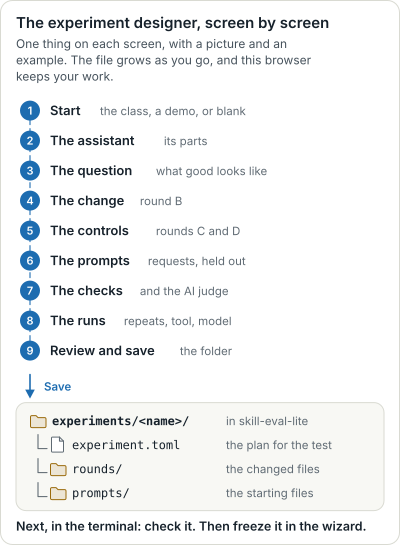/" width="400"> 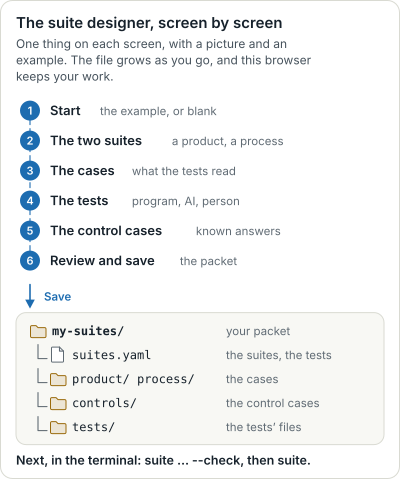

**The experiment designer** (Shared I) starts from the class experiment, a
demonstration, or blank. It reads your assistant's folder, read only, to list
its parts (or you type them); you choose the part round B changes on a
picture of them, and how, and write the new version in an editor that starts
from the file's own text. It suggests the two controls (remove the knowledge
graph; reorder a file's sections, which it does for you) and asks for each
round's prediction; then the prompts (the class prompts, or your own with
their starting files), development or held out, with a balance meter; the
checks, from a menu of the kinds the runner supports, and the AI judge's
prompt from a template; and the repeats, the tool, the model and a budget.
The last screen tells the experiment back in sentences, lists every check,
and saves `experiments/<name>/` (`experiment.toml`, `rounds/`, `prompts/`):
straight into the folder you choose, in Chrome or Edge, or as a ZIP to
unzip there:

    unzip -o ~/Downloads/<name>.zip -d experiments

Then, as for an intake, `python3 run_ab.py check experiments/<name>/experiment.toml`,
and load and freeze it in the wizard's steps 1 and 2.

**The suite designer** (Personal I) starts from the worked example or blank,
and makes the packet: the two suites (a product or a stage, and a process),
their cases (files from your computer, a folder of cases, or pasted), the
tests of each kind (a built-in check or a program; a judge prompt or a
skill, with its decision rule; a rating scale with anchors, or a
comparison), and the control cases (a reference, planted faults and harmless
variations, each made from a case and changed, with what each test should
return; a process case's steps can be edited one by one), with a balance for
each test. It saves the packet next to `skill-eval-lite` (or as a ZIP:
`unzip -o ~/Downloads/my-suites.zip -d ..`). Then:

    python3 run_ab.py suite ../my-suites/suites.yaml --check
    python3 run_ab.py suite ../my-suites/suites.yaml

`dev/embed_examples.py` writes the class experiment's files, the
demonstrations and the worked example into the wizard, for the designers to
start from (`--check` says whether they are up to date).

## Personal I: suites

A *suite* is a set of tests that run together on every case. A packet holds
`suites.yaml`, the cases (`product/<item>/`, `stage/<item>/` or
`process/<item>/`, each with `context.md`), the control cases
(`controls/<suite>/<case>/`, each with `expect.json`) and the tests' files
(`tests/<test>/`). `examples/personal-suites/` is a worked example on the
class assistant: a product suite on six real board drafts and a process
suite on four real recorded runs, three tests each (mechanical, LLM and
human), each suite with a reference, two planted faults and two harmless
variations.

1. **Copy the example** (or make your own packet in the same shape):

       cp -r examples/personal-suites ../my-suites

2. **Check it, then run every mechanical and LLM test on every case:**

       python3 run_ab.py suite ../my-suites/suites.yaml --check
       python3 run_ab.py suite ../my-suites/suites.yaml

   Each LLM test runs in a fresh, isolated Claude Code session per case (20
   for the example, a few seconds each), and every run is kept in
   `tests/<test>/runs/`. A row per result is added to `judgments.csv` (rows
   are only ever added), and a report per suite is written to `reports/`.
   An LLM test already run for its current version is not run again
   (`--again` reruns it); `--no-llm` runs the mechanical tests only.

3. **Open the wizard and load `../my-suites/bundle.json`** in step 1. The
   wizard switches to its checks-only mode, in four steps:
   - *Suites*: each suite's cases, what each control should do, and its tests.
   - *Reference*: your own judgment of each LLM test's criterion on every
     case, with a reason, before you see the LLM's; then you and the LLM
     side by side.
   - *Human tests*: each case on its own (or two side by side, for a
     comparison), shuffled, with the control cases mixed in and nothing to
     say which they are; another test's result appears only after you record
     yours. Ask a classmate to do the same in their browser.
   - *Report*: a row per case and a column per test, the failures, where the
     tests disagree, whether each test did what the control cases expect,
     and the agreement (the LLM with your reference; you with your second
     rater).

4. **Export** `judgments.csv` into the packet (it holds every row, the
   runner's and yours), and each suite's report into `reports/`. Import your
   second rater's `judgments.csv` in the report step.

The worked example's recorded run, with eight real LLM test runs, is
`examples/recorded/personal-suites/`: load its `bundle.json` to see the mode
without running anything.

### The suites file

`schema: skill-eval-lite/suites@1`; YAML (the subset the brief's examples
need: mappings, lists, quoted and plain values, `|` and `>` blocks), or the
same structure as `suites.json` or `suites.toml`.

| Field | Holds |
| --- | --- |
| `suites[].id`, `object`, `what` | The suite's ID; `product`, `stage` or `process`; what it tests |
| `suites[].items` | The instances or runs: folders under `<object>/` |
| `suites[].file` | The file in each case that is the product (default `output.md`) |
| `suites[].tests[]` | `id`, `kind` (`mechanical`, `llm` or `human`), `question`, `criterion`, `why` |
| mechanical | `check`: a built-in check (the kinds under "The experiment file"; a process case's trace is its `transcript.jsonl` or `trace.jsonl`), or `program`: any program that takes the case's folder and prints `pass` or `fail` and a reason on one line |
| llm | `prompt` (a prompt file; `{{case}}` marks where the case goes, else it is added at the end) or `skill` (a SKILL.md); `model`; `decision` (the rule: the last line is PASS, FAIL or UNKNOWN) |
| human | `form` (`rating` or `comparison`), `scale` (each point and what it means), `pass_at` (the lowest passing rating), `instructions`, `pairs` (for a comparison) |

A control case's `expect.json` gives its `role` (`reference`, `fault` or
`variation`), the case a variation `varies`, a `note`, and `expect`: for each
test, `pass`, `fail`, `same` (as the case it varies) or `any`. A reference
expects every test to pass, and a variation the same results as its
original, unless `expect` says otherwise. A test's `version` is the first 12
characters of the SHA-256 of its definition and files, so a changed test is
a new version with a new report.

## What a run does

For each prompt, round and repeat, in an order shuffled with the
experiment's seed, the runner:

1. copies the assistant's folder into a new temporary folder, leaving out
   `.git`, `.claude/settings.local.json`, `CLAUDE.local.md`,
   `writing-samples/`, `.claude/setup/answers.md`, the intake skill, and
   earlier work in `drafts/`, `notes/` and `research/`;
2. applies the round's change to that copy: `as-is` (none), `removed` (the
   part's paths deleted), `blank` (the part's file emptied, or replaced by
   `change.file`), or `revised`, `neutral-edit` and `someone-else's` (the
   part's file replaced by `change.file`, kept under `rounds/<id>/` at the
   path it replaces);
3. puts the prompt's starting files in place (`input/...`);
4. runs Claude Code in print mode in the copy, with the prompt on its input
   and the isolation flags in [SAFETY.md](SAFETY.md), and checks the
   session's first event: if anything of yours is loaded (an MCP server, a
   connector, a plugin, a personal skill, auto memory), the run is stopped,
   no further runs start, and the runner says STOPPED;
5. keeps the output: the files the run wrote in the folder the request
   names (`Save it in drafts/.`), or, if it wrote none, its last message.
   Name a folder in the request when you want the draft alone judged;
6. deletes the copy.

A run that fails or passes its time limit is kept as a failure, never as
missing, and fails every check.

## The run folder

`runs/<experiment>/` holds most of the packet that Shared I asks for:

    experiment.toml                the experiment as it was run
    bundle.json                    everything the wizard needs, in one file
    versions/<round>/              CHANGE.md and the round's files
    prompts/<id>/                  prompt.md, reference.md, files/
    outputs/<prompt>/<round>/<repeat>/
        output.md                  what is judged and checked
        message.md                 the assistant's last message
        run.json                   model, date, seconds, status (ok, failed or timeout),
                                   cost, the exact command, the transcript's path,
                                   what the isolation check saw
        trace.jsonl                one step a line: {"tool", "detail", "error"}
        files/                     every file the run wrote
    transcripts/<prompt>__<round>__<repeat>.jsonl   the session's events
    judge/prompt.md                the judging prompt
    judge/<A-B>/<prompt>__<repeat>.json   each judgment: the input, the response, the side shown left

Paths in these files are relative to the run's folder; your home folder,
user and host names, session IDs, account usage and real e-mail addresses
are left out.

The wizard writes the rest: `judgments.csv`, with the columns `item, config,
object, check, route, judge, version, result, reason, shown_left, when` (your
judgments, the LLM judge's and every check's, and the checks on each
reference output with `config = reference`), `results.json`, and the frozen
experiment.

## The experiment file

`schema = "skill-eval-lite/experiment@1"`. TOML (or the same structure as
JSON). `examples/class-assistant/experiment.toml` uses every field.

| Field | Holds |
| --- | --- |
| `title`, `purpose`, `criterion`, `judging_question` | The question; what the outputs are for; what makes one good enough to use; the question every blind pair answers |
| `repeats`, `seed` | Runs per prompt per round; the seed for the run order, the judge's sides and the bootstrap |
| `demo` | `true` for a demonstration that is not a full experiment |
| `files_from` | Where `rounds/` and `prompts/` are, relative to this file (default: its folder) |
| `[system]`, `[[system.parts]]` | The assistant, and one entry per part: `id`, `path` (or `paths`), `words`, `reaches_model` |
| `[[rounds]]` | `id`, `label`, `role` (`baseline`, `improvement`, `control-should-change`, `control-should-not-change`), `change = { part, how, file }`, `expected = { direction, tags, elsewhere, sources }`, `why` |
| `[[comparisons]]` | `baseline` and `new`: the pairs that are judged; the first whose new round is an improvement is the headline |
| `[controls]` | `tolerance`: how far a source may move and still count as "stayed" (0.10) |
| `[[behaviors]]` | `id`, `description`: what the prompt set is balanced on |
| `[prompts]` | `development`, `held_out`, `sealed` |
| `[[prompt]]` | `id`, `title`, `tags`, `should`, `should_not`, `files` (paths in the run), `text`, `reference` |
| `[model]` | `runner` (`"claude-code"` or `"codex"`), `model`, `allowed_tools`, `timeout_seconds`, `max_budget_usd`, `note`; for Codex also `codex_model`, `reasoning_effort` |
| `[[checks]]` | `id`, `kind`, `object` (`product` or `process`), the kind's arguments, `prompts` or `tags`, `shows`, `does_not_show` |
| `[judge]` | `model`, `prompt` (ending in one line: LEFT, RIGHT, TIE or UNKNOWN), `decision` |
| `[frozen]` | `date`, `hash`: written by the wizard |
| `[provenance]` | Who wrote the file, when, with which skill |

The check kinds: `contains` (every `text` appears), `not-contains` (none
does), `matches` (the regular expression `pattern` matches), `word-count`
(`min`, `max`), `json-parses`, `trace-ran-command` (a shell command in the
trace matches the glob `pattern`, in a step that didn't fail) and
`trace-no-tool-outside` (every step matches the `allowed` list, each command
of a shell step included). The wizard runs them; the runner doesn't.

`allowed_tools` sets what a run may use: `Read`, `Write`, `Edit`, `Glob` and
`Grep` work inside the run's folder only; `Bash kb/kb *` allows those shell
commands (Claude Code also allows simple read-only commands such as `ls` and
`cat` inside the folder).

## Stuck? Ask for help

Two commands tell you where you are and help you with the next step. Type
them in the terminal, in the `skill-eval-lite` folder.

    python3 run_ab.py status

This says what is ready (Python, git, Claude Code or Codex, your login, the
class assistant), which experiments and runs you have, and the one next
step, with the exact command to type. It doesn't use your plan.

    python3 run_ab.py ask

This opens Claude Code as your helper (add `--runner codex` for Codex). It
knows where you are. It asks you a few questions, one at a time: which
project, which assistant, whether you have an experiment yet. Then it takes
you through the next step. It explains each command before it runs it, and
runs it only after you say yes. As in a run, your own settings, MCP servers
and connectors are left out. If Claude Code asks whether you trust this
folder, choose Yes. Type `/exit` when you are done.

To ask one question and get one answer:

    python3 run_ab.py ask "how do I freeze my experiment?"

To start your group's experiment from the class experiment:

    python3 run_ab.py new <name> --from class

This copies the class experiment, with its round and prompt files, into
`experiments/<name>/`. Change what your group wants to test, then check it.
For your group's own assistant, use the intake instead (`/experiment-intake`
in Claude Code). A helper session and each answer use a little of your plan.

## Commands

    python3 run_ab.py setup FOLDER [--from URL] [--commit SHA]
    python3 run_ab.py status [--assistant FOLDER] [--runner R] [--json]
    python3 run_ab.py ask [--runner R] ["a question"]
    python3 run_ab.py new NAME [--from class|EXPERIMENT]
    python3 run_ab.py doctor [--runner R] [--no-probe]
    python3 run_ab.py check EXPERIMENT
    python3 run_ab.py plan EXPERIMENT [--runner R] [--rounds A,C] [--prompts ID,ID] [--repeats N] [--held-out] [--jobs N]
    python3 run_ab.py run EXPERIMENT --assistant FOLDER [--runner R] [--model M] [--rounds A,C] [--prompts ID,ID]
                          [--repeats N] [--held-out] [--jobs N] [--out FOLDER] [--again] [--keep-work]
    python3 run_ab.py judge RUN_FOLDER [--runner R] [--comparisons A-B,A-C] [--model M] [--jobs N] [--again]
    python3 run_ab.py suite SUITES_FILE [--runner R] [--suite ID] [--tests ID,ID] [--cases ID,ID] [--out FOLDER]
                            [--again] [--no-llm] [--check] [--jobs N]

`R` is `claude-code` (the default) or `codex`. With Codex, `--use-api-key`
uses `OPENAI_API_KEY` instead of your ChatGPT plan's login.

`python3 run_ab.py COMMAND --help` describes each option.

## Tested

On 2026-10-26, on Linux, with Claude Code 2.1.310 logged in to a Claude
plan, and with model `claude-sonnet-5-5` for the runs and the judge:

| Demonstration | Runs | Wall time, `--jobs 4` | Each run | Judge (2 pairs) | Cost, as Claude Code reports it |
| --- | --- | --- | --- | --- | --- |
| `demo-graph-removed` | 4, all ok | 54 s | 21 to 54 s | 7 s | $0.43 for the runs, $0.03 for the judge |
| `demo-voice-reordered` | 4, all ok | 27 s | 11 to 27 s | 10 s | $0.31, $0.03 |
| `demo-board-memo` | 4, all ok | 25 s | 20 to 24 s | 11 s | $0.37, $0.04 |

The checks-only mode's LLM tests were run for real on eight cases of the
worked example (four per suite, each 6 to 10 s, $0.12 in all), recorded in
`examples/recorded/personal-suites/`. They found two problems in the
example's own control cases, which are left in as a worked finding (see
`examples/personal-suites/README.md`).

On 2026-10-27, with Claude Code 2.1.311 and an API key, in a fresh home
folder and a fresh clone (`dev/fresh-trial.sh --keep-api-key`):
`demo-one-line` ran its 6 runs, all ok, in 16 s with `--jobs 6` (each run 6
to 16 s, $0.28), and the judge its 3 pairs in 6 s ($0.03). Wren often
tries to save a draft with a shell command (`mkdir -p drafts && cat > …
<<'EOF'`), which the run refuses. It usually saves the draft with its Write
tool instead, but in four such trials about one run in six returned the
draft inside a message with notes, so that its output is long. The recorded
run is in `examples/recorded/demo-one-line/`.

On a Claude plan the cost is what the same use would cost through the API;
the plan's usage limits apply instead. Every run's first event showed no MCP
servers, no connector tools, only Claude Code's built-in plugins, no
personal skills, and auto memory off ([SAFETY.md](SAFETY.md)). The recorded
runs are in `examples/recorded/`.

The tests (`python3 -m unittest`) run the whole pipeline
offline with a stand-in for `claude` (`tests/fake_claude.py`): setup from a
local template, runs, a timeout and a failure kept as failures, a run that
loads a connector stopped, a Claude Code that isn't logged in, the bundle,
the judge, and nothing personal saved. They check that the wizard's TOML
reader agrees with Python's `tomllib` on every example, and walk the wizard
in headless Chrome (when it is installed): a runner's bundle, the recorded
runs and the practice pack, from step 1 to the exports, with no console
errors, its bootstrap interval matching a Python reimplementation. For the
checks-only mode they test the YAML reader, `suite` with the fake `claude`
(rows only added, versions, a missed control marked, agreement counts, every
LLM run kept), and walk the mode in Chrome: reference judgments, ratings, a
comparison with its side recorded, and the exported reports, which must
match `run_ab.py`'s line for line.

For the designers (`tests/test_designer.py`), they check in Chrome that the
class start, the demonstrations and the worked example, written out
unchanged, match `examples/`; that awkward text survives the TOML and YAML
writers; that the designers' copies of `check` and `suite --check` say what
`run_ab.py` says, word for word, on the class experiment and fifteen broken
versions of it, and on the worked example and nine broken packets; and three journeys through the page's own buttons and fields: an
experiment from the class start, changed; one from blank, with an
assistant's folder, a new prompt and a starting file; and a packet from
blank. Each is saved as a ZIP (and through a stand-in for the folder
picker), unzipped into a copy of `skill-eval-lite`, and passes `check` (and
runs 32 times with the fake `claude`), or `suite --check` and `suite` with
the fake `claude`; the first loads in step 1 and freezes, and the packet's
bundle loads in the checks-only mode. Every screen fits 390 px with no
sideways scroll, every field has a label, and the keyboard works (Enter
chooses, Tab moves on, Space picks a part).

On a Claude plan, with no API key (2026-10-26): a fresh clone from the
private remote, Claude Code 2.1.311 logged in through claude.ai. `doctor`
passed (0 MCP servers, 0 connector tools, auto memory off; the probe took
2.4 s), `setup` made the class assistant, and `demo-graph-removed` ran its
4 runs in 34 seconds with `--jobs 4` (estimated $0.40) with none failed;
the judge preferred round A on both pairs.

With Codex (2026-10-26): Codex CLI 0.164.0 on Linux, logged in to a
ChatGPT plan (`OPENAI_API_KEY` was set in the environment and left out of
every run), model `gpt-6.1-sol` at its default reasoning effort (`low`) for
the runs and the judge:

| Demonstration | Runs | Wall time, `--jobs 4` | Each run | Judge (2 pairs) | Usage, as Codex reports it |
| --- | --- | --- | --- | --- | --- |
| `demo-graph-removed` | 4, all ok | 44 s | 26 to 42 s | 12.5 s (8 and 11 s) | runs: 461,911 tokens in (372,608 cached), 3,469 out; judge: about 9,700 in and 140 out a pair |

Round A searched the graph (`kb/kb search`, `kb/kb node`) and read the
`knowledge-graph` skill; round C found no graph and said so. The judge
preferred round A on both pairs, and the renewal-amount check passed on one
of A's two briefs and on neither of C's. Each A run took about 145,000
input tokens, most of them cached, against 85,000 for C. The `doctor` probe
(`gpt-6-luna`) took 3.9 s and 18,456 tokens in. Every run's check found
nothing of the person's loaded ([SAFETY.md](SAFETY.md), "Codex"). The run
is recorded in `examples/recorded/demo-graph-removed-codex/`. The other two
demonstrations and the suites' LLM tests were not run on Codex for real;
`suite --runner codex` was tested with the stand-in.

The Codex tests (`tests/test_codex.py`) use a stand-in for `codex`
(`tests/fake_codex.py`) that answers from the `CODEX_HOME` it is given, as
Codex does: runs, the judge, a suite's LLM tests and `doctor`; that only the
runner's config and a link to the login reach Codex, with no API key unless
asked; that a global `AGENTS.md`, a personal skill, an MCP tool or an MCP
call stops the run; that runners are not mixed; and the import inlining,
the trace names and the check before each run on their own.

## Limits in 0.1.0

- The runner runs Claude Code or Codex. A Codex run reads the assistant
  through a generated `AGENTS.md` (see "With Codex"), so its results are not
  comparable with Claude Code's. With a chat window, paste each output into
  the wizard's step 3.
- Codex was tested at 0.164.0 on Linux only, and `--use-api-key` only with
  the stand-in.
- Tested on Linux. Not yet on macOS or Windows.
- The checks-only mode reads suites the runner has run; the wizard itself
  runs no tests and calls no model. A suite's LLM tests use Claude Code, or
  Codex with `--runner codex` (tested with the stand-in only).
- The wizard doesn't unseal the held-out prompts, or read another group's
  packet for the exchange; it reads ZIP files not at all (load
  `bundle.json`).
- The designers save straight into a folder only in browsers with the File
  System Access API (Chrome, Edge); elsewhere they download a ZIP. A
  program test that isn't Python, saved that way, needs `chmod +x`. They
  keep a design in this browser only: save the folder to keep it for good.
  They were tested in headless Chrome on Linux, with the folder picker
  replaced by a stand-in.

## Where it comes from

The wizard's code began as a one-file prototype written for the course; it
is copied here and extended to read the runner's bundles. The class
assistant is the AI 5100 assistant template
(https://github.com/vanderbilt-ms-ai/assistant-template), cloned at a
pinned commit when you run `setup`; `class-assistant/overlay/` holds only
what the class adds (knowledge-graph pages for the template's fictional
example) and `overlay.toml`, the list of copies `setup` makes. The template
is licensed CC BY-NC-SA 4.0; the class's pages and round files are adapted
from its example.
