# Skill Eval Lite

New here? Open `starting.html` first: a guided tour with a worked example.

Working in Claude? Open this folder in the Claude desktop app's Code tab and
type `/get-ready`: see "Doing it all in Claude" for every skill.

Skill Eval Lite tests whether one change to an AI assistant makes its work
better. You describe the experiment in one file, `experiment.toml`: the
assistant's parts, the rounds (the assistant as it is, a change and two
controls), the prompts with reference outputs, the checks and a judging
prompt. The runner, `run_ab.py`, runs every round on every prompt with
Claude Code, each run in a fresh copy of the assistant with nothing of yours
loaded and keeps every output, record and trace. The wizard, `wizard.html`,
loads the runs, shows you blind pairs to judge and reports the results,
including whether each check, the LLM judge and the people moved when they
should have.

For Personal I there is a checks-only mode: suites of mechanical, LLM and
human tests run on every case of a product and a process, with control
cases and reported together (see "Personal I: suites").

You don't have to write either file by hand. The wizard's two designers make
them on screen, one question at a time, with a picture and an example on
each screen: the experiment designer (Shared I) and the suite designer
(Personal I). See "Make the file on screen".

It was made for AI 5500 (Vanderbilt, Fall 2026), for Shared I and Personal I. The class
assistant is Wren, the AI 5100 assistant template's fictional example: Wren
works for Morgan Reyes and nobody in it is real.

Version 0.2.3 (the version is in `VERSION`). On an earlier version? In Claude, in this folder, type
`/check-updates`; in a terminal, `git pull`. [RELEASE.md](RELEASE.md) says what changed. Claude checks
for a newer version by itself, at the start of a session, once a day.

## Getting started, in pictures

Skill Eval Lite has two parts. You work in *Claude*, in its desktop app's
Code tab with *This computer* chosen, in a session on this folder: you say
what you want and Claude runs the commands, asking you first. Then you
freeze, judge and read the results in the *wizard*, `wizard.html`, a page in
your web browser. The wizard opens on a *Getting started* screen with every
step of every path: what to type to Claude or click, a picture of it, what
you should see and what to do if you don't. It fills in your own folder
names and has a Copy button for each message. The same step typed in a
terminal is folded under each message, for those who prefer it.

Not Cowork, the app's other mode: its commands run on a computer in the
cloud, which can't run Skill Eval Lite (see "Doing it all in Claude").

**Stuck?** In Claude, in your session on `skill-eval-lite`, ask "Where am I
and what should I do next?" Claude runs `run_ab.py status` and gives you the
next step, with the skill for it. In a terminal, `python3 run_ab.py status`
does the same.

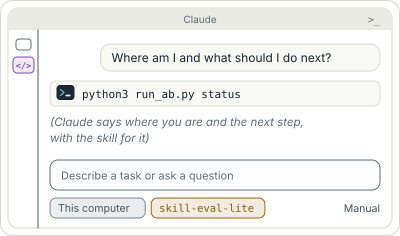

### Which path are you on?

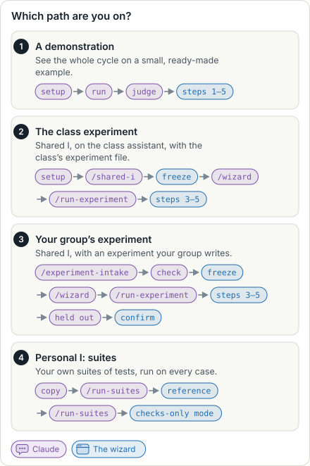

Each path has a picture of its order: which steps happen in Claude and which
in the wizard.

- [A demonstration](docs/diagrams/order-demo.svg): see the whole cycle once,
  on a small example. Start here if you are new.
- [The class experiment](docs/diagrams/order-class.svg): Shared I, on the
  class assistant, with the course's experiment file.
- [Your group's experiment](docs/diagrams/order-group.svg): Shared I, with an
  experiment your group writes. Its steps are below.
- [Personal I: suites](docs/diagrams/order-suites.svg): your own suites of
  tests, in the wizard's checks-only mode.

### The order of a real experiment

The order is not obvious, so here it is. The intake skill
(`/experiment-intake`) writes the experiment file with your group. Claude
checks it. Then the wizard *freezes* it. Freezing writes your experiment
down, with the date and a fingerprint, before you see any results, so that
nobody can change the test to fit the results later. The runner uses the
frozen file, so you export it from the wizard and Claude puts it back in its
folder (`/wizard`) before it runs the rounds and the AI judge
(`/run-experiment`). Then the wizard again, for judging and the results. Once
your group's changes are final, Claude runs the held-out prompts and you
judge them in the wizard, which reports the confirmation. A demonstration is
shorter: its file is a small example, so it is run first and frozen
afterwards.

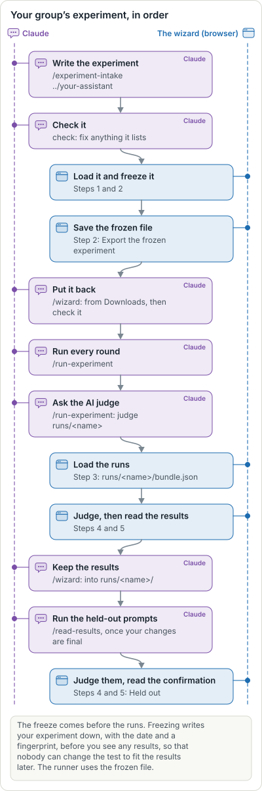 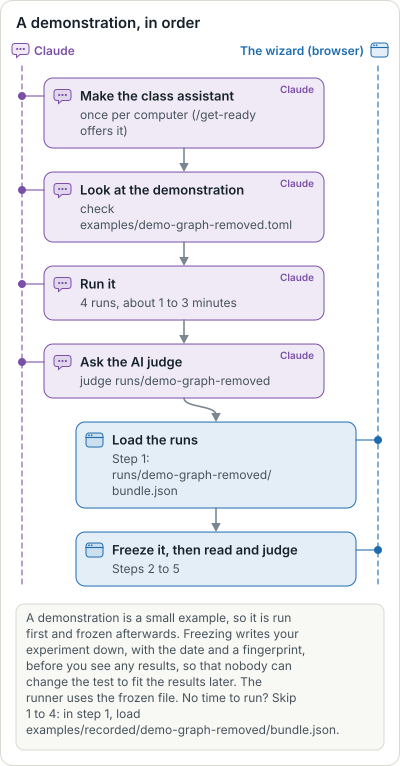

### Do I need to run the intake skill first?

Only for your group's own experiment. The *intake skill* is a set of
instructions that lets Claude write your experiment file with your group. In
Claude, in your session on this folder, type
`/experiment-intake ../your-assistant`. With Codex, ask it to follow
`AGENTS.md`. Your assistant's folder must be a git project with a
`CLAUDE.md` (the assistant's main instructions). If it isn't, the intake
explains what is needed. Only if you say yes, it makes the folder a git
project with a first commit. It never writes your assistant's instructions.

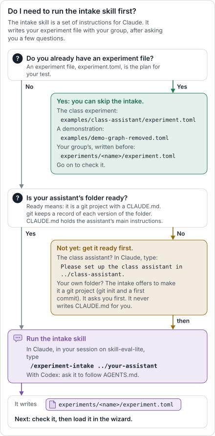

Or make the file on screen instead, with the wizard's experiment designer:
see "Make the file on screen".

### Where everything is

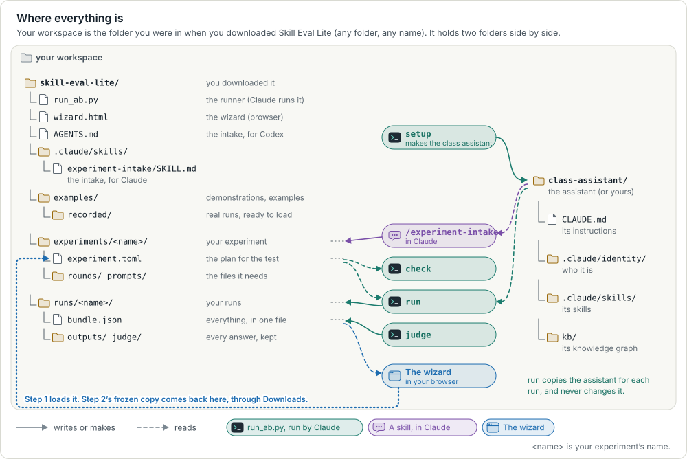

### Meet the class assistant

Wren is the class assistant. Wren works for Morgan Reyes. Both are made up:
they are the fictional example in the AI 5100 assistant template. Wren
drafts Morgan's replies, summaries and briefs, which Morgan sends under
Morgan's own name. Wren is a folder of files and each file is a part that an
experiment can change.

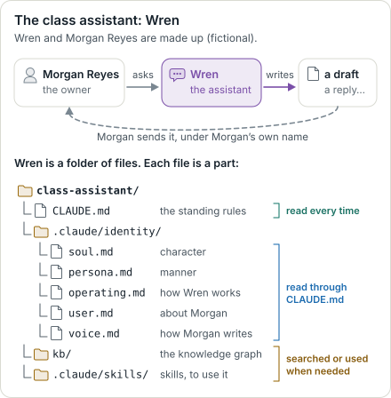

### One step at a time

<b>First time on this computer</b>: seven steps, once.

<!-- steps:first:begin (written by dev/diagrams.mjs from the wizard's steps; edit them in wizard.html) -->

1. **Install Claude’s desktop app and sign in.** *On your computer.* Skill Eval Lite is used through Claude, in the desktop app’s *Code* tab, which works in a folder on your computer. It needs a paid Claude plan: Pro, Max, Ultra, Team or Enterprise.

   On a Mac: Open claude.com/download, download Claude for macOS, open the .dmg file and drag Claude onto Applications. On Windows: Open claude.com/download, download Claude for Windows and open the installer. On Linux: Open claude.com/download and follow its Linux instructions (the Linux app is in beta).

   You should see: Claude’s window, signed in with your account.

   If not: It asks you to upgrade? The Code tab needs a paid plan.

   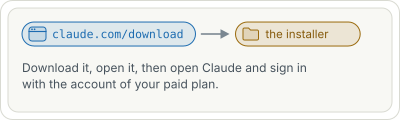

2. **Make a folder for the course.** *On your computer.* In Finder or File Explorer, make a folder called `ai5500` in your home folder. Please keep it out of OneDrive, iCloud Drive and your Desktop, which copy files while programs write them.

   You should see: An empty folder, `ai5500`, in your home folder.

   If not: Can’t find your home folder? On a Mac, press Command, Shift and H in Finder. On Windows, type %USERPROFILE% in File Explorer’s address bar.

   

3. **Open the folder in the Code tab.** *On your computer.* In Claude, click the Code button, `</>`, at the top of the sidebar. In the row under the message box, choose *This computer*, then the folder control, *Open folder…* and `ai5500`. Choose *Manual* in the mode menu: Claude then asks before it changes a file or runs a command.

   You should see: `ai5500` under the message box, which reads “Describe a task or ask a question”.

   If not: Claude can’t see your files? You chose another environment: choose *This computer*.

   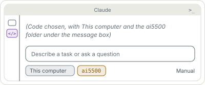

4. **Ask Claude to download Skill Eval Lite.** *In Claude.* Type this in the session on `ai5500`. Claude says what it will run and asks first. Already have Skill Eval Lite? Ask Claude to update it instead, keeping your `experiments` and `runs` folders.

   Type this in Claude, then press Enter:

       Please download Skill Eval Lite into this folder as skill-eval-lite: git clone https://github.com/vanderbilt-ms-ai/skill-eval-lite if git is installed. If it isn’t, download https://github.com/vanderbilt-ms-ai/skill-eval-lite/archive/refs/heads/main.zip, unpack it here and rename the folder skill-eval-lite.

   In a terminal instead, in the `ai5500` folder:

       git clone https://github.com/vanderbilt-ms-ai/skill-eval-lite

   You should see: A folder `skill-eval-lite` in `ai5500`.

   If not: Claude can’t reach GitHub? Check your internet connection and ask again.

   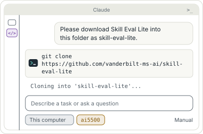

5. **Open a session on skill-eval-lite.** *On your computer.* Click *+ New* in the sidebar. Choose *This computer*, then *Open folder…* and `skill-eval-lite`, inside `ai5500`. Do everything after this in a session on this folder: that is where Claude finds Skill Eval Lite’s skills.

   You should see: Type `/` in the message box: a list with `get-ready`, `wizard`, `shared-i`, `personal-i` and more.

   If not: No Skill Eval Lite skills in the list? The session is on another folder: start a new one on `skill-eval-lite`.

   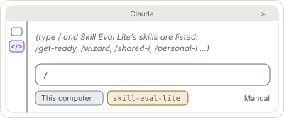

6. **Get your computer ready.** *In Claude.* Claude checks Python 3.11 or later, git and the `claude` command (a separate copy of Claude Code that Skill Eval Lite’s runner uses) and its sign-in. It installs what is missing, one thing at a time, after you say yes. Then it runs `doctor`, which makes one tiny test run on your plan.

   Type this in Claude, then press Enter:

       /get-ready

   In a terminal instead, in the `skill-eval-lite` folder:

       python3 run_ab.py doctor

   You should see: Every line of `doctor` starts with `ok`.

   If not: Claude can’t sign the `claude` command in? Click the Terminal button, `>_`, at the top right of the window, type `claude auth login` and sign in in your browser. Then type `/get-ready` again.

   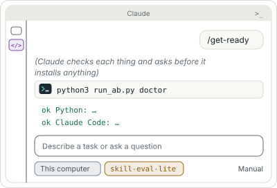

7. **Open the wizard.** *In Claude.* The *wizard* is this page, `wizard.html` in the `skill-eval-lite` folder. Claude opens it in your web browser. Please use the same browser each time: the wizard keeps your work in it.

   Type this in Claude, then press Enter:

       /wizard Please open the wizard on its Getting started screen.

   In a terminal instead, in the `skill-eval-lite` folder:

       open wizard.html

   On Linux:

       xdg-open wizard.html

   On Windows (PowerShell):

       start wizard.html

   You should see: This page, in your browser.

   If not: Nothing opens? Double-click `wizard.html` in the `skill-eval-lite` folder instead.

   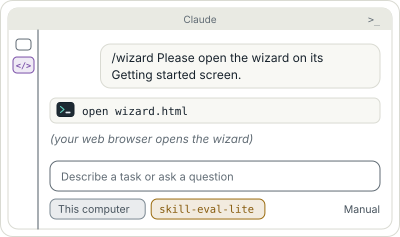

<!-- steps:first:end -->

<b>Your group's experiment</b>: every step, from the intake to the results.

<!-- steps:group:begin (written by dev/diagrams.mjs from the wizard's steps; edit them in wizard.html) -->

1. **Make the class assistant, if you use it.** *In Claude.* Claude makes Wren, the class assistant, in a new folder called `class-assistant`, next to `skill-eval-lite`. (`../` means “next to this folder”.) You only do this once: `/get-ready` offers it too. Using your own assistant instead? Put its folder next to `skill-eval-lite`. Skip this step.

   Type this in Claude, then press Enter:

       Please set up the class assistant in ../class-assistant.

   In a terminal instead, in the `skill-eval-lite` folder:

       python3 run_ab.py setup ../class-assistant

   You should see: `The class assistant is ready in ../class-assistant`

   If not: Claude says the folder `already exists and is not empty`? You made it before. Go on to the next step.

   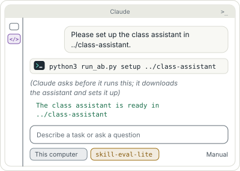

2. **Start the intake.** *In Claude.* Type this in Claude, in your session on `skill-eval-lite`. The *intake skill* reads your assistant’s files, then asks your group up to five questions, one at a time. Using Codex instead? Ask it to follow `AGENTS.md` to write an experiment intake for ../your-assistant.

   Type this in Claude, then press Enter:

       /experiment-intake ../your-assistant

   You should see: A list of the assistant’s parts, then a first question.

   If not: Claude doesn’t know `/experiment-intake`? The session is on another folder: start a new one on `skill-eval-lite`.

   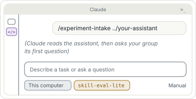

3. **Answer its questions, together.** *In Claude.* Answer in your own words. It suggests the versions to compare, the requests and the checks: correct anything that is wrong. At the end it writes `experiments/<name>/experiment.toml`. Note the name it gives: it is *&lt;name&gt;* in the steps below.

   You should see: “I wrote experiments/…/experiment.toml” and a checklist.

   If not: Stuck on a question? Ask it to explain, or say “please suggest an answer”.

   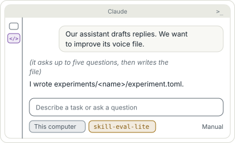

4. **Check it.** *In Claude.* `check` reads the experiment file and lists anything missing or wrong. `/critique` reads it against the brief, if you want a second look before you freeze.

   Type this in Claude, then press Enter:

       Please check experiments/<name>/experiment.toml.

   In a terminal instead, in the `skill-eval-lite` folder:

       python3 run_ab.py check experiments/<name>/experiment.toml

   You should see: `Nothing is missing.` and `Frozen: not yet`.

   If not: Lines that start with `must fix`? Ask Claude: “Please fix the errors that check lists.”

   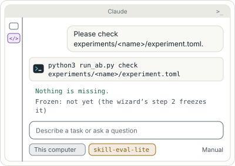

5. **Load your experiment file into the wizard.** *In the wizard.* Ask Claude to open the wizard (`/wizard`) or open this page, then press *Go to step 1* below. In the window that opens, pick your experiment file.

   Click: In step 1, under “Your experiment file”, click *choose a file*.

   You should see: A summary of your experiment, with “Nothing is missing.” in green.

   If not: Something listed in red? Ask Claude to fix it in the file, then load it again.

   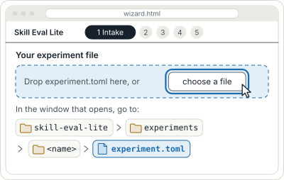

6. **Freeze it.** *In the wizard.* *Freezing* writes your experiment down, with the date and a fingerprint, before you see any results, so that nobody can change the test to fit the results later. The runner uses the frozen file.

   Click: In step 2, read the list, then click *Freeze*.

   You should see: “The record”, with the date and a fingerprint.

   If not: Is *Freeze* grey? An item on the list is not met. Fix it in the file, load it again in step 1 and come back.

   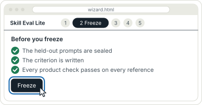

7. **Save the frozen file.** *In the wizard.* The frozen file is your experiment file with the freeze written at the end. The runner must run this one.

   Click: Still in step 2, click *Export the frozen experiment*.

   You should see: Your browser saves `experiment.toml` in your Downloads folder.

   If not: If it is saved as `experiment (1).toml`, an older one was there. Claude takes the newest one in the next step.

   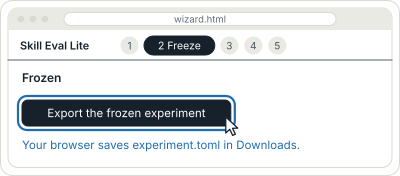

8. **Put the frozen file back in its folder.** *In Claude.* Claude finds the newest `experiment.toml` in your Downloads folder, keeps the earlier file under its date, puts the frozen one in `experiments/<name>` and checks it.

   Type this in Claude, then press Enter:

       /wizard I’ve exported the frozen experiment. Please put it back in experiments/<name> and check it.

   In a terminal instead, in the `skill-eval-lite` folder:

       mv ~/Downloads/experiment.toml experiments/<name>/experiment.toml

   On Windows (PowerShell):

       Move-Item -Force ~/Downloads/experiment.toml experiments/<name>/experiment.toml

   You should see: `Frozen: yes`, with today’s date.

   If not: `Frozen: not yet`? The old file is still there: ask Claude to look in Downloads again. `The file has changed since it was frozen`? Someone edited it after the freeze: freeze it again.

   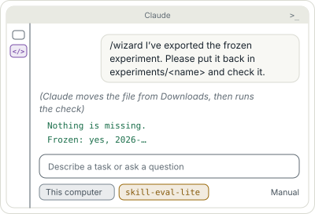

9. **Run every round.** *In Claude.* Claude checks that the file is frozen, says how many runs it makes and about how long they take. It asks first. Every version gets every development request, twice: with 4 versions and 4 requests, 32 runs, 4 at a time, about 5 to 15 minutes. Each run is one session on your plan. You can leave it running.

   Type this in Claude, then press Enter:

       /run-experiment Please run every round of experiments/<name>/experiment.toml on ../your-assistant.

   In a terminal instead, in the `skill-eval-lite` folder:

       python3 run_ab.py run experiments/<name>/experiment.toml --assistant ../your-assistant --jobs 4

   You should see: A line for each run, then `The bundle for the wizard: runs/<name>/bundle.json`

   If not: A run that failed is kept as a failure; that is all right. Stopped? Ask Claude to run it again: finished runs are not run twice.

   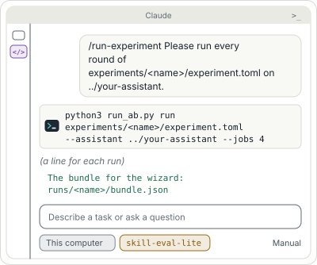

10. **Ask the AI judge.** *In Claude.* The *AI judge* is a language model that compares two answers to the same request. It doesn’t know which version wrote which. Your own judgments come later, in the wizard. Claude doesn’t read its verdicts out to you.

   Type this in Claude, then press Enter:

       /run-experiment Please run the AI judge on runs/<name>.

   In a terminal instead, in the `skill-eval-lite` folder:

       python3 run_ab.py judge runs/<name>

   You should see: `The judge's verdicts are saved in runs/<name>/bundle.json`

   If not: `There is no bundle.json`? The runs didn’t finish. Ask Claude to run them again: finished runs are not run twice.

   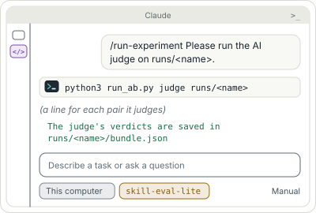

11. **Load the runs.** *In the wizard.* A *bundle* is one file, `bundle.json`, that holds everything from the runs: the plan and every answer. Pick it in the window that opens.

   Click: In step 3, under “Your runs”, click *choose a file*.

   You should see: Under “Coverage”, a green “ok” for each run.

   If not: Can’t find the file? It is in the `skill-eval-lite` folder, then `runs`, then `<name>`.

   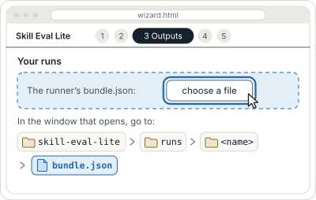

12. **Start judging.** *In the wizard.* Each of you judges alone, under your own initials. Please don’t compare notes until you have all finished.

   Click: In step 4, type your initials and click *Start*.

   You should see: Two answers side by side, called Left and Right.

   If not: Step 4 is grey? Load the runs first (step 3).

   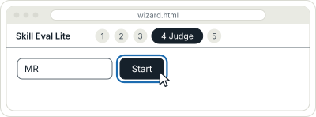

13. **Judge each pair.** *In the wizard.* Read both answers against the question in blue. You can’t see which version wrote which until you record your choice.

   Click: Choose *Left is better*, *About the same* or *Right is better*. Write one line saying why. Click *Record*.

   You should see: After each one, which version wrote each side. Then *Next pair →*.

   If not: *Record* is grey? Choose one of the three, then write your reason.

   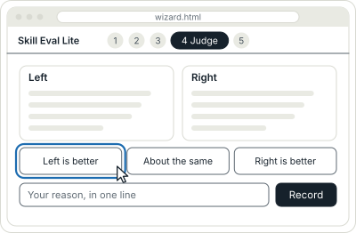

14. **Read the results and save them.** *In the wizard.* Step 5 shows how often you preferred the new version and whether the controls moved as they should. Send `judgments.csv` to your teammates. Import theirs here.

   Click: In step 5, click *Export judgments.csv*, then *Export results.json*.

   You should see: Two files in your Downloads folder.

   If not: The buttons are grey? Judge at least one pair in step 4.

   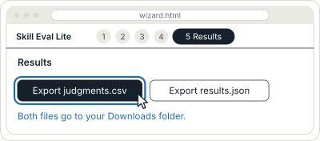

15. **Keep the results with the runs.** *In Claude.* Claude takes the newest of each from your Downloads folder and puts them in `runs/<name>`, beside the runs.

   Type this in Claude, then press Enter:

       /wizard I’ve exported judgments.csv and results.json. Please keep them with the runs in runs/<name>.

   In a terminal instead, in the `skill-eval-lite` folder:

       mv ~/Downloads/judgments.csv ~/Downloads/results.json runs/<name>/

   On Windows (PowerShell):

       Move-Item -Force ~/Downloads/judgments.csv, ~/Downloads/results.json runs/<name>/

   You should see: Claude says where it put `judgments.csv` and `results.json`.

   If not: A name ends in (1)? Claude uses the newest file. Tell it if you exported again.

   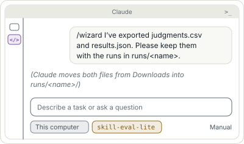

16. **Run the held-out prompts, once your changes are final.** *In Claude.* The held-out prompts stay sealed until your group’s changes are final. Then Claude runs round A and your final version on them, then the AI judge on their pairs. (In the terminal command, put your final round where it says B.)

   Type this in Claude, then press Enter:

       /read-results Our changes are final. Please run the held-out prompts.

   In a terminal instead, in the `skill-eval-lite` folder:

       python3 run_ab.py run experiments/<name>/experiment.toml --assistant ../your-assistant --rounds A,B --held-out --jobs 4

   You should see: A line for each held-out run, then the judge’s line.

   If not: Claude asks whether your changes are final? It never unseals the held-out prompts before you say so.

   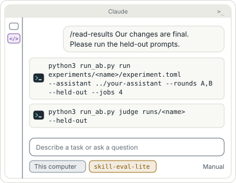

17. **Judge the held-out pairs, each of you alone.** *In the wizard.* The held-out pairs are a set of their own, judged blind like the others: sides varied, versions hidden, a reason for each.

   Click: Load the new `bundle.json` in step 3. In step 4, click *Held out: the confirmation*, then judge each pair as before.

   You should see: Two answers side by side, under *Held out: the confirmation*.

   If not: No held-out set in step 4? The bundle has no held-out runs yet: load the one Claude made in the step before.

   

18. **Read the confirmation.** *In the wizard.* It gives the held-out share with its interval, beside the development result for the same comparison. With two prompts the interval is wide: say what it supports.

   Click: In step 5, read *Held out: the confirmation*, under the main result. Then export `judgments.csv` and `results.json` again.

   You should see: “Held out: the confirmation”, with its share and its interval.

   If not: It says the confirmation needs round A run on them too? Ask Claude to run round A on the held-out prompts.

   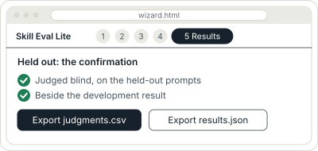

<!-- steps:group:end -->

The other paths' steps, each with its picture, are on the wizard's Getting
started screen and in `docs/diagrams/steps/`.

## What you need

- Claude's desktop app on a Mac or a Windows computer (the Linux app is in
  beta), with a paid Claude plan: Pro, Max, Ultra, Team or Enterprise. You
  work in its Code tab, with *This computer* chosen, in a session on this
  folder. `/get-ready` checks and installs the rest, one thing at a time,
  after you say yes.
- Python 3.11 or later (`python3 --version`; on Windows, `py --version`).
- git.
- A web browser.
- The `claude` command: a separate copy of Claude Code, which the runner
  starts for every run. `/get-ready` installs it and signs it in. No API key
  is needed: it uses your plan's login. Each run is one Claude Code
  session on your plan. The dollar amounts the runner prints are Claude
  Code's own estimates; on a plan they count toward its usage limits rather
  than being billed. (If `ANTHROPIC_API_KEY` is set, Claude Code uses the
  key instead and the runs are billed to it; `doctor` says which login is in
  use. `unset ANTHROPIC_API_KEY` returns you to your plan.) To install it
  yourself (https://code.claude.com/docs/en/setup):

      curl -fsSL https://claude.ai/install.sh | bash      # macOS, Linux
      irm https://claude.ai/install.ps1 | iex             # Windows PowerShell

  The installer puts it in `~/.local/bin`. The runner looks there too, so
  you needn't add that folder to your PATH.

- Or Codex instead of Claude Code, with a paid ChatGPT plan that includes it
  (https://developers.openai.com/codex/cli). No API key is needed: run
  `codex login` once and sign in with your ChatGPT account. Add
  `--runner codex` to `doctor`, `run`, `judge` and `suite` (see "With
  Codex" below). If `OPENAI_API_KEY` is set, runs leave it out and use your
  plan; `--use-api-key` uses the key instead, billed to it.

Nothing else: the runner uses Python's standard library and the wizard is
one HTML file that works offline.

## Walkthrough

Each step is a message to type in Claude, in its desktop app's Code tab, in a
session on this folder; Claude runs the command and asks you first. The same
command, for a terminal, is under each one. On Windows, type `py` where a
command says `python3`.

1. **Get Skill Eval Lite.** In a session on the folder that will hold it (the
   course's `ai5500`), type:

       Please download Skill Eval Lite into this folder as skill-eval-lite.

   Then open a new session on `skill-eval-lite`. In a terminal:

       git clone https://github.com/vanderbilt-ms-ai/skill-eval-lite
       cd skill-eval-lite

2. **Check your setup.** Type `/get-ready`. Claude checks Python, git, the
   `claude` command and its sign-in, installs what is missing after you say
   yes, then runs `doctor`. It makes one tiny run (a few seconds, well under
   a cent) to show that your own settings, memory, plugins, MCP servers and
   connectors stay out of a run. Every line should say `ok`. In a terminal,
   after logging in to Claude Code once (`claude auth login`):

       python3 run_ab.py doctor

3. **Set up the class assistant.** `/get-ready` offers it, or type:

       Please set up the class assistant in ../class-assistant.

   Claude runs `python3 run_ab.py setup ../class-assistant`. This clones the
   AI 5100 assistant template from GitHub at a pinned commit, puts its
   fictional example in place with the class's knowledge graph pages and
   commits the result on a branch, `class-assistant`. To use another
   assistant instead, give its folder (any git project with a `CLAUDE.md`)
   wherever these steps say `../class-assistant`.

4. **Look at the experiment.** Open `examples/demo-one-line.toml` (or ask
   Claude to show it to you): round A is Wren as it is, round B adds one
   line to Wren's voice file. The three prompts ask for short replies (to
   Sam, Ms. Okafor and Priya). The line is in
   `examples/class-assistant/rounds/one-line/.claude/identity/voice.md`,
   under "House rule": "Keep every reply under 40 words." Ask Claude to
   change it to a line of your own if you like: that is round B. Then:

       Please check examples/demo-one-line.toml and plan it, 6 at a time.

   In a terminal:

       python3 run_ab.py check examples/demo-one-line.toml
       python3 run_ab.py plan examples/demo-one-line.toml --jobs 6

5. **Run it.**

       Please run examples/demo-one-line.toml on ../class-assistant, 6 at a time.

   In a terminal:

       python3 run_ab.py run examples/demo-one-line.toml --assistant ../class-assistant --jobs 6

   Six runs, six at a time: about half a minute. The runs are kept in
   `runs/demo-one-line/`, failures included. To run it again with another
   line, add `--again` (finished runs are otherwise not run twice). Add
   `--again` to `judge` too: otherwise it keeps the verdicts on the earlier
   outputs and says every pair is already judged.

6. **Run the LLM judge** on the blind pairs.

       Please run the AI judge on runs/demo-one-line.

   In a terminal: `python3 run_ab.py judge runs/demo-one-line`.

7. **Open the wizard.** Type `/wizard`, or double-click `wizard.html`. In a
   terminal:

       open wizard.html          # macOS
       xdg-open wizard.html      # Linux
       start wizard.html         # Windows

8. **Step 1, Intake:** drop `runs/demo-one-line/bundle.json` on "A run
   you have made" (or choose it). The wizard reads the experiment from it
   and summarizes it.

9. **Step 2, Freeze:** read the checklist and press *Freeze this
   demonstration*. (A full experiment passes every item and gets *Freeze*.)

10. **Step 3, Outputs:** every prompt, round and repeat has a cell. Open one
    to read the output, the assistant's route and its checks.

11. **Step 4, Judge:** type your initials and press *Start*. For each pair,
    choose *Left is better*, *About the same* or *Right is better*, give a
    one-line reason and press *Record*. Which round wrote which side is
    shown only after you record. *Fast judging*, a box under your initials,
    is for a quick pass or a room voting together: one click records, the
    reason is optional and *Skip →* leaves a pair for later (the numbered
    dots go back to it). Keys: L, S and R record; → skips, or goes on.

12. **Step 5, Results:** the share of judgments that preferred the newer
    round, with its 95% interval; then *Did the evaluation move when it
    should?*, which compares each source (people, the LLM judge, each check)
    with the round's prediction.

13. **Export:** *Export judgments.csv*, *Export results.json* and *Export the
    frozen experiment*. Import a teammate's `judgments.csv` in step 5 to
    combine your judgments.

The other demonstrations run the same way, or load their recorded runs in
step 1 without running anything:

| Demonstration | Rounds | What should happen | Recorded run |
| --- | --- | --- | --- |
| `examples/demo-one-line.toml` | A, B (one line added to the voice file) | what the line predicts; for "under 40 words", shorter replies | `examples/recorded/demo-one-line/bundle.json` |
| `examples/demo-graph-removed.toml` | A, C (graph removed) | C gets worse | `examples/recorded/demo-graph-removed/bundle.json` |
| `examples/demo-voice-reordered.toml` | A, D (voice file reordered) | nothing moves | `examples/recorded/demo-voice-reordered/bundle.json` |
| `examples/demo-board-memo.toml` | A, B (board memo section written) | B's board drafts get better | `examples/recorded/demo-board-memo/bundle.json` |

The wizard also has *Use the class assistant's intake* (step 1) and, for
that intake, made-up practice outputs (step 3), labelled as made up.

## With Codex

If your paid plan is for Codex (ChatGPT's coding agent) rather than Claude
Code, every step above works the same with `--runner codex` added:

    python3 run_ab.py doctor --runner codex
    python3 run_ab.py run examples/demo-graph-removed.toml --assistant ../class-assistant --runner codex --jobs 4
    python3 run_ab.py judge runs/demo-graph-removed-codex

The runs go in `runs/<experiment>-codex/` and `judge` uses Codex for a
folder of Codex runs. A real Codex run of the first demonstration, with its
judge, is in `examples/recorded/demo-graph-removed-codex/bundle.json`.

**A Codex run evaluates the assistant's instructions as Codex reads them.**
The class assistant is a Claude Code assistant: `CLAUDE.md`, which imports
the files in `.claude/identity/` with `@` lines and skills in
`.claude/skills/`. Codex reads neither. For each run, in the run's fresh
copy only, the runner writes `AGENTS.md` (the file Codex reads) from
`CLAUDE.md` with every `@` import replaced by the imported file's text, and
copies each `.claude/skills/<name>/` to `.agents/skills/<name>/`, where Codex
finds skills (it lists them by name and description and reads one when it
chooses, as Claude Code does). The assistant's own files are not changed.
Each run's `run.json` records this under `codex_mapping`, with what was not
mapped (Claude Code settings and slash commands). So Codex results and
Claude Code results are not interchangeable: run every round of one
comparison with the same runner. The runner refuses to add Codex runs to a
folder of Claude Code runs and `judge` refuses a folder that mixes them.

In the experiment file, `[model]` can say `runner = "codex"` and name a
Codex model (`model = "gpt-6.1-sol"`, the default); with `--runner codex`
on a file written for Claude Code, a Claude model name is replaced by
Codex's default, or by `[model].codex_model`. `reasoning_effort` (for
example `"low"`) is passed to Codex. Codex has no cost cap: the time limit
is the only limit and it reports tokens rather than dollars. On a ChatGPT
plan they count toward the plan's usage limits.

Codex's tools differ from Claude Code's: it reads files with shell commands
(`cat`, `rg`) and edits them with its own patch tool. So that the same
checks read both runners' traces, a single read-only command is named in
the trace as the tool Claude Code would have used (`Read`, `Glob`, `Grep`;
reading a skill's `SKILL.md` is `Skill`), with the command kept as its
detail; a file Codex writes is `Write` or `Edit`; anything else is `Bash`.
Codex has no per-command allow list like `Bash kb/kb *`: its sandbox
confines every command instead (SAFETY.md, "Codex").

## Your own experiment

The full class experiment is `examples/class-assistant/experiment.toml`, with
its round files under `rounds/` and its prompts' starting files under
`prompts/`. It has four rounds (A as it is; B, the voice file's missing
board memo section; C, the graph removed; D, the voice file reordered), four
development prompts and two held out and two repeats: 32 runs on the
development prompts, the two controls twice each like A and B, as the
Shared I brief asks and 8 more on the held-out prompts at the end.

To write an intake for your group's assistant, type the intake skill's name
with the assistant's folder in Claude, in your session on this folder:

    /experiment-intake ../class-assistant

With Codex, ask it here to follow `AGENTS.md`. The agent reads the
assistant, asks your group at most five questions and writes
`experiments/<name>/experiment.toml` with its round and prompt files. The
skill is `.claude/skills/experiment-intake/SKILL.md`; `AGENTS.md` is the same
text (Claude Code reads it too, in this folder). If you copy either into
the assistant's folder instead, the runner leaves it out of every run, and
leaves out an experiment folder kept inside the assistant.

Then, each a message to Claude (the command, for a terminal, in brackets):

1. "Please check experiments/<name>/experiment.toml." Fix every error with
   it. (`python3 run_ab.py check experiments/<name>/experiment.toml`)
2. Load the file in the wizard (`/wizard` opens it) in step 1, read the
   summary and freeze it in step 2. Still in step 2, *Export the frozen
   experiment*. Then "/wizard I've exported the frozen experiment. Please
   put it back in experiments/<name> and check it.": the run uses the frozen
   file.
3. "/run-experiment Please run every round of experiments/<name>/experiment.toml
   on <folder>." This runs every round, the two controls included, twice on
   each development prompt, as the Shared I brief asks. Runs already in the
   run folder are not run again (`--again` replaces them).
   (`python3 run_ab.py run experiments/<name>/experiment.toml --assistant <folder> --jobs 4`)
4. "/run-experiment Please run the AI judge on runs/<name>." Then load
   `runs/<name>/bundle.json` in the wizard's step 3 and judge.
   (`python3 run_ab.py judge runs/<name>`)

The held-out prompts stay sealed: `run` and `judge` leave them out unless you
add `--held-out`. When your group's changes are final, type "/read-results
Our changes are final. Please run the held-out prompts.": Claude runs A and
your final version on them (`run … --rounds A,F --held-out`), then
`judge runs/<name> --held-out`. The confirmation is A against each round run
on the held-out prompts, so the frozen file needs no new comparison. In the
wizard, step 3 shows their runs. Step 4 adds their pairs as a set of their
own (*Held out: the confirmation*), judged blind as before. Step 5 reports
it beside the development result (`held_out` in `results.json`).
Their rows in `judgments.csv` say `blind-preference-held-out` (the judge's,
`llm-judge-held-out`); the checks' rows name the held-out prompt in `item`.

### A check of your own: program checks

A check that none of the built-in kinds can make, but that code can decide
the same way every time (the order of a run's steps; "only these amounts"; a
date copied from the starting file), can be a *program check*: a short
Python program of your group's own, `kind = "program"`, in
`experiments/<name>/checks/<id>/`. [CHECKS.md](CHECKS.md) says how to write
one, with its *fixtures* (small made-up cases with the answer it should
give). In Claude, the check-authoring skill writes one with you:

    /check-authoring

With Codex, ask it to follow `CHECKS.md`. `check` runs each program on the
references and on its fixtures and prints the `sha256` line to put in the
check, which brings the program under the freeze. `run` runs the programs on
every output at the end and the wizard shows their results beside the
built-in checks'. To run a program check on runs already made (one added
after them, say), with no new runs and no model, ask Claude to score the
runs again (`python3 run_ab.py score experiments/<name>/experiment.toml`).

A check added after the runs is marked *added after the runs* in the
wizard: its results are exploratory, not part of the test you froze.
`examples/demo-program-check.toml` is a demonstration with two program
checks, in `examples/class-assistant/checks/`.

## Make the file on screen: the designers

The wizard has two designers. Open the wizard and on Getting started press
*With the designer* (under "Make a new experiment file") or *With the suite
designer*; step 1 has the same buttons. Each screen asks one thing, with a
picture, plain words and an example from the class experiment and shows the
file as it grows and the checks it will have to pass, in the words that
`check` (or `suite --check`) uses. Your work is kept in this browser, so you
can stop and come back; *Start over* clears it.

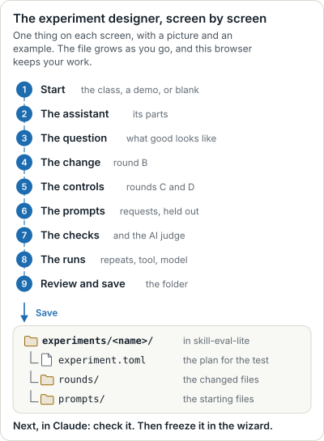/" width="400"> 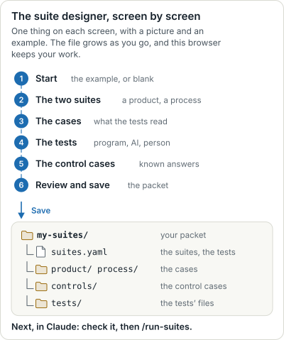

**The experiment designer** (Shared I) starts from the class experiment, a
demonstration, or blank. It reads your assistant's folder, read only, to list
its parts (or you type them). On a picture of them you choose the part
round B changes and how it changes. You write the new version in an editor
that starts from the file's own text. It suggests the two controls (remove the knowledge
graph; reorder a file's sections, which it does for you) and asks for each
round's prediction; then the prompts (the class prompts, or your own with
their starting files), development or held out, with a balance meter; the
checks, from a menu of the built-in kinds (a program check it is given, from
a demonstration, it keeps as it is, with its folder) and the AI judge's
prompt from a template; and the repeats, the tool, the model and a budget.
The last screen tells the experiment back in sentences, lists every check,
and saves `experiments/<name>/` (`experiment.toml`, `rounds/`, `prompts/`):
straight into the folder you choose, in Chrome or Edge, or as a ZIP that
Claude unzips there ("/wizard I've downloaded <name>.zip from the designer.
Please unzip it into experiments."; in a terminal,
`unzip -o ~/Downloads/<name>.zip -d experiments`).

Then, as for an intake, ask Claude to check it
(`python3 run_ab.py check experiments/<name>/experiment.toml`). Then load and
freeze it in the wizard's steps 1 and 2.

**The suite designer** (Personal I) starts from the worked example or blank,
and makes the packet: the two suites (a product or a stage and a process),
their cases (files from your computer, a folder of cases, or pasted), the
tests of each kind (a built-in check or a program; a judge prompt or a
skill, with its decision rule; a rating scale with anchors, or a
comparison) and the control cases (a reference, planted faults and harmless
variations, each made from a case and changed, with what each test should
return; a process case's steps can be edited one by one), with a balance for
each test. It saves the packet next to `skill-eval-lite` (or as a ZIP, which
Claude unzips there: `unzip -o ~/Downloads/my-suites.zip -d ..`). Then, in
Claude, "Please check my suites, ../my-suites/suites.yaml." and `/run-suites`,
as "Personal I: suites" below says.

`dev/embed_examples.py` writes the class experiment's files, the
demonstrations and the worked example into the wizard, for the designers to
start from (`--check` says whether they are up to date).

## Personal I: suites

A *suite* is a set of tests that run together on every case. A packet holds
`suites.yaml`, the cases (`product/<item>/`, `stage/<item>/` or
`process/<item>/`, each with `context.md`), the control cases
(`controls/<suite>/<case>/`, each with `expect.json`) and the tests' files
(`tests/<test>/`). `examples/personal-suites/` is a worked example on the
class assistant: a product suite on six real board drafts and a process
suite on four real recorded runs, three tests each (mechanical, LLM and
human), each suite with a reference, two planted faults and two harmless
variations.

Each step is a message to Claude, in your session on this folder; the
command, for a terminal, is under it. `/personal-i` guides the whole
project. `/suites-intake` helps you make your own packet.

1. **Copy the example** (or make your own packet in the same shape):

       Please copy the worked example, examples/personal-suites, to ../my-suites.

   In a terminal: `cp -r examples/personal-suites ../my-suites`.

2. **Check it, then run the mechanical tests on every case** (no model):

       /run-suites Please run the mechanical tests in my suites, ../my-suites.

   Claude runs these:

       python3 run_ab.py suite ../my-suites/suites.yaml --check
       python3 run_ab.py suite ../my-suites/suites.yaml --no-llm

3. **Your own reference first.** `suite` prints each LLM test's verdict as
   it runs, so judge each LLM test's criterion yourself before it runs: open
   the wizard (`/wizard`), load `../my-suites/bundle.json` in step 1, make
   your judgments in the Reference step and export `judgments.csv`. Claude
   adds its rows to the packet's ("/wizard I've exported judgments.csv with
   my reference. Please put it in my packet."). Then run the LLM tests:

       /run-suites My reference is in my packet. Please run the LLM tests.

   In a terminal: `python3 run_ab.py suite ../my-suites/suites.yaml`.

   Each LLM test runs in a fresh, isolated Claude Code session per case (20
   for the example, a few seconds each) and every run is kept in
   `tests/<test>/runs/`. A row per result is added to `judgments.csv` (rows
   are only ever added) and a report per suite is written to `reports/`.
   An LLM test already run for its current version is not run again
   (`--again` reruns it).

4. **Open the wizard and load `../my-suites/bundle.json`** in step 1. The
   wizard switches to its checks-only mode, in four steps:
   - *Suites*: each suite's cases, what each control should do and its tests.
   - *Reference*: your own judgment of each LLM test's criterion on every
     case, with a reason, before you see the LLM's; then you and the LLM
     side by side.
   - *Human tests*: each case on its own (or two side by side, for a
     comparison), shuffled, with the control cases mixed in and nothing to
     say which they are; another test's result appears only after you record
     yours. Ask a classmate to do the same in their browser.
   - *Report*: a row per case and a column per test, the failures, where the
     tests disagree, whether each test did what the control cases expect,
     and the agreement (the LLM with your reference; you with your second
     rater).

5. **Export** `judgments.csv` (it holds every row, the runner's and yours)
   and each suite's report. Claude puts them in the packet and its
   `reports/` ("/wizard I've exported judgments.csv and the reports. Please
   put them in my packet."). Import your second rater's `judgments.csv` in
   the report step.

The worked example's recorded run, with eight real LLM test runs, is
`examples/recorded/personal-suites/`: load its `bundle.json` to see the mode
without running anything.

### The suites file

`schema: skill-eval-lite/suites@1`; YAML (the subset the brief's examples
need: mappings, lists, quoted and plain values, `|` and `>` blocks), or the
same structure as `suites.json` or `suites.toml`.

| Field | Holds |
| --- | --- |
| `suites[].id`, `object`, `what` | The suite's ID; `product`, `stage` or `process`; what it tests |
| `suites[].items` | The instances or runs: folders under `<object>/` |
| `suites[].file` | The file in each case that is the product (default `output.md`) |
| `suites[].tests[]` | `id`, `kind` (`mechanical`, `llm` or `human`), `question`, `criterion`, `why` |
| mechanical | `check`: a built-in check (the kinds under "The experiment file"; a process case's trace is its record, below), or `program`: any program that takes the case's folder and prints `pass` or `fail` and a reason on one line, or `n/a` and a reason when it can't test the case (a case with no record, say), so that nothing tested is not counted as a failure |
| llm | `prompt` (a prompt file; `{{case}}` marks where the case goes, else it is added at the end) or `skill` (a SKILL.md); `model`; `decision` (the rule: the last line is PASS, FAIL or UNKNOWN, as below) |
| human | `form` (`rating` or `comparison`), `scale` (each point and what it means), `pass_at` (the lowest passing rating), `instructions`, `pairs` (for a comparison) |

A process case's record of its run is one file in its folder: either
`transcript.jsonl` (a Claude Code or Codex session's events: copy a saved
session in under this name) or `trace.jsonl` (one step a line: `{"tool",
"detail", "error"}`). If a case has both, `transcript.jsonl` is read, and
`suite --check` asks you to keep only one. `suite --check` also says when a
case has no record, has a record under another name, has a line that isn't
JSON (with its number), or has a record with no steps in it.

An LLM test's verdict is the last line of its response that isn't blank,
with `**`, backticks and trailing full stops taken off: `PASS`, `FAIL` or
`UNKNOWN`. A label is read too (`Verdict: PASS`, `Final answer - FAIL`), and
so is a line with one of the three words in it and no `not` before it (`The
answer passes: PASS`); anything else is unknown and the row's reason says
why. The LLM judge's last line is read the same way, for LEFT, RIGHT, TIE or
UNKNOWN. A stored run that an earlier version scored unknown and that this
rule reads as pass or fail, gets a new row ("re-read with 0.1.1's rule; no
new run"), with no new run and the report marks it "(re-read)".

A control case's `expect.json` gives its `role` (`reference`, `fault` or
`variation`), the case it `varies` (the case it was made from: a variation
must say, a fault may), a `note` and `expect`: for each test, `pass`,
`fail`, `same` (as the case it varies) or `any`. A reference expects every
test to pass and a variation the same results as its original, unless
`expect` says otherwise. A test's `version` is the first 12 characters of
the SHA-256 of its definition and files, so a changed test is a new version
with a new report.

In the report's controls table, a cell reads `ok` when the test did what
the control expects and `MISSED` when it didn't. A control made from the
reference (a variation, or a fault whose `varies` names the reference)
reads `shows nothing: the test fails reference too` when the test doesn't
pass the reference (it fails, or can't tell): the control carries the
reference's own result, so it can't show whether the test catches the fault
or ignores the harmless change. A note under the table names each such test.
Look at why the reference fails it first.

## What a run does

For each prompt, round and repeat, in an order shuffled with the
experiment's seed, the runner:

1. copies the assistant's folder into a new temporary folder, leaving out
   `.git`, `.claude/settings.local.json`, `CLAUDE.local.md`,
   `writing-samples/`, `.claude/setup/answers.md`, Skill Eval Lite's own
   skills and guides (every skill marked as Skill Eval Lite's, under any
   folder name: the intake, the helper, check-authoring and the rest), the program
   checks' folders and earlier work in `drafts/`, `notes/` and `research/`;
2. applies the round's change to that copy: `as-is` (none), `removed` (the
   part's paths deleted), `blank` (the part's file emptied, or replaced by
   `change.file`), or `revised`, `neutral-edit` and `someone-else's` (the
   part's file replaced by `change.file`, kept under `rounds/<id>/` at the
   path it replaces);
3. puts the prompt's starting files in place (`input/...`);
4. runs Claude Code in print mode in the copy, with the prompt on its input
   and the isolation flags in [SAFETY.md](SAFETY.md) and checks the
   session's first event: if anything of yours is loaded (an MCP server, a
   connector, a plugin, a personal skill, auto memory), the run is stopped,
   no further runs start and the runner says STOPPED;
5. keeps the output: the files the run wrote in the folder the request
   names (`Save it in drafts/.`), or, if it wrote none, its last message.
   Name a folder in the request when you want the draft alone judged;
6. deletes the copy.

A run that fails or passes its time limit is kept as a failure, never as
missing and fails every check.

Before the first run, the runner tests each program check as `check` does
(on the references and its fixtures) and doesn't start if one fails. After
the runs, it runs each program check on every output it applies to that has
no result for the check as it is now (its version is its program's `sha256`
and its `params`). Each time, the program gets a fresh folder holding the
output, the reference, the trace, the transcript, the files the run wrote,
the starting files and a `context.json`, but never the round, the repeat or
the run's folder. It runs with Python's isolated mode, in that folder, with
no API keys and a time limit ([CHECKS.md](CHECKS.md), [SAFETY.md](SAFETY.md)).
A failed or timed-out run isn't given to it.

## The run folder

`runs/<experiment>/` holds most of the packet that Shared I asks for:

    experiment.toml                the experiment as it was run
    bundle.json                    everything the wizard needs, in one file
    versions/<round>/              CHANGE.md and the round's files
    prompts/<id>/                  prompt.md, reference.md, files/
    outputs/<prompt>/<round>/<repeat>/
        output.md                  what is judged and checked
        message.md                 the assistant's last message
        run.json                   model, date, seconds, status (ok, failed or timeout),
                                   cost, the exact command, the transcript's path,
                                   what the isolation check saw
        trace.jsonl                one step a line: {"tool", "detail", "error"}, and
                                   "refused": true for a step Claude Code refused (it never ran)
        files/                     every file the run wrote
    transcripts/<prompt>__<round>__<repeat>.jsonl   the session's events
    judge/prompt.md                the judging prompt
    judge/<A-B>/<prompt>__<repeat>.json   each judgment: the input, the response, the side shown left
    checks/<id>/                   each program check's program and fixtures, as they were run
    outputs/<prompt>/<round>/<repeat>/checks/<id>.json   a program check's result on that output

`bundle.json` carries the program checks' results too: `program_results`
(one for each output and check, with its version and `added_after_run` when
the runs were made without that version of the check) and
`program_reference_results`. Each output says which versions of the program
checks it was made with (`program_checks`).

Paths in these files are relative to the run's folder; your home folder,
user and host names, session IDs, account usage and real e-mail addresses
are left out.

The wizard writes the rest: `judgments.csv`, with the columns `item, config,
object, check, route, judge, version, result, reason, shown_left, when` (your
judgments, the LLM judge's and every check's and the checks on each
reference output with `config = reference`), `results.json` and the frozen
experiment.

## The experiment file

`schema = "skill-eval-lite/experiment@1"`. TOML (or the same structure as
JSON). `examples/class-assistant/experiment.toml` uses every field.

| Field | Holds |
| --- | --- |
| `title`, `purpose`, `criterion`, `judging_question` | The question; what the outputs are for; what makes one good enough to use; the question every blind pair answers |
| `repeats`, `seed` | Runs per prompt per round; the seed for the run order, the judge's sides and the bootstrap |
| `demo` | `true` for a demonstration that is not a full experiment |
| `files_from` | Where `rounds/`, `prompts/` and `checks/` are, relative to this file (default: its folder) |
| `[system]`, `[[system.parts]]` | The assistant and one entry per part: `id`, `path` (or `paths`), `words`, `reaches_model` |
| `[[rounds]]` | `id`, `label`, `role` (`baseline`, `improvement`, `control-should-change`, `control-should-not-change`), `change = { part, how, file }`, `expected = { direction, tags, elsewhere, sources }`, `why` |
| `[[comparisons]]` | `baseline` and `new`: the pairs that are judged; the first whose new round is an improvement is the headline |
| `[controls]` | `tolerance`: how far a source may move and still count as "stayed" (0.10) |
| `[[behaviors]]` | `id`, `description`: what the prompt set is balanced on |
| `[prompts]` | `development`, `held_out`, `sealed` |
| `[[prompt]]` | `id`, `title`, `tags`, `should`, `should_not`, `files` (paths in the run), `text`, `reference` |
| `[model]` | `runner` (`"claude-code"` or `"codex"`), `model`, `allowed_tools`, `timeout_seconds`, `max_budget_usd`, `note`; for Codex also `codex_model`, `reasoning_effort` |
| `[[checks]]` | `id`, `kind`, `object` (`product` or `process`), the kind's arguments, `prompts` or `tags`, `shows`, `does_not_show`; for a program check, `program` (`checks/<folder>/<name>.py`), `sha256` (the program's, which `check` prints) and optionally `params` (a table the program reads) and `timeout_seconds` (1 to 600; 60) |
| `[judge]` | `model`, `prompt` (ending in one line: LEFT, RIGHT, TIE or UNKNOWN), `decision` |
| `[frozen]` | `date`, `hash`: written by the wizard. The hash is `sha256c:` and the SHA-256 of the file without its `[frozen]` table (for JSON, without `frozen`, keys sorted), so `check`, `status`, `run` and the wizard can each check that the file hasn't changed since. A 0.1.0 freeze (`sha256:`) is read as frozen, with a note that it can't be checked |
| `[provenance]` | Who wrote the file, when, with which skill |

The check kinds: `contains` (every `text` appears), `not-contains` (none
does), `matches` (the regular expression `pattern` matches, with `flags`
`i`, `m` or `s` if it needs them), `word-count`
(`min`, `max`), `json-parses`, `trace-ran-command` (a shell command in the
trace matches the glob `pattern`, in a step that didn't fail) and
`trace-no-tool-outside` (every step matches the `allowed` list, each command
of a shell step included). The wizard runs them on Shared I's runs, and
`suite` on Personal I's cases. And `program`: a program of your own, which
the runner runs (see "A check of your own: program checks" above, and
[CHECKS.md](CHECKS.md)). It prints `pass`, `fail` or `n/a` and a reason on
its first line; anything else counts as `n/a`.

How the two trace checks read a shell step:
- A step is split into its commands at `;`, `&&`, `||`, `|`, `&` and new
  lines, but not inside quotes, after a backslash, inside `$(...)` or
  backticks, or in a heredoc's body. So `grep "a|b" notes.md` is one
  command. The commands in `( ... )` or `{ ...; }` are taken one by one. A
  command inside `$(...)` is not checked on its own.
- In a pattern, `*` matches anything and a pattern that ends in ` *` also
  matches the command alone (`ls *` matches `ls`). A pattern matches the
  whole command, also with a leading `./`, the directories before the
  pattern's own program, `NAME=value` settings, or `command`, `exec` or
  `time` taken off. So `kb/kb search*` matches `./kb/kb search Dana`,
  `/tmp/run-1/kb/kb search Dana` and `KB_DEBUG=1 kb/kb search Dana`, but
  not `echo "kb/kb search"`.
- Claude Code records one success for a whole step, its last command's. When
  `trace-ran-command`'s match is in a chain, its reason says so: in `kb/kb
  search Dana | head`, the search may have failed and `head` succeeded.
- `trace-no-tool-outside` doesn't count a step Claude Code refused, or that
  the person rejected in an interactive session (it never ran) and lists
  them in its reason. A command that writes a
  file through `>` or `>>` (not `2>&1` or `> /dev/null`) is allowed only by
  a pattern that itself has `>`.

`allowed_tools` sets what a run may use: `Read`, `Write`, `Edit`, `Glob` and
`Grep` work inside the run's folder only; `Bash kb/kb *` allows those shell
commands (Claude Code also allows simple read-only commands such as `ls` and
`cat` inside the folder).

## Stuck? Ask for help

Two commands tell you where you are and help you with the next step. In
Claude, ask "Where am I and what should I do next?": Claude runs the first
and tells you, with the skill for the next step (`/shared-i` and
`/personal-i` guide each project). In a terminal, type them in the
`skill-eval-lite` folder.

    python3 run_ab.py status

This says what is ready (Python, git, Claude Code or Codex, your login, the
class assistant), which experiments and runs you have and the one next
step: the skill that does it in Claude, then the exact command for a
terminal (with Codex, the command alone). `--json` gives each step's
`skill` and `command`. It calls no model. On Personal I,
it follows your packet: with a packet beside this folder (`../my-suites`)
and no experiment of your own, it gives Personal I's next step (check it,
run it, the wizard, the export) and never asks for Wren. With both, it
gives a step for each. `--project shared` or `--project personal` gives one
project's steps, if your folders are laid out some other way. Each step
that uses a model says who pays: your plan, or your API key.

    python3 run_ab.py ask

In a terminal, this opens Claude Code as your helper (add `--runner codex` for Codex). It
knows where you are. It asks you a few questions, one at a time: which
project, which assistant, whether you have an experiment yet. Then it takes
you through the next step. It explains each command before it runs it, and
runs it only after you say yes. As in a run, your own settings, MCP servers
and connectors are left out. If Claude Code asks whether you trust this
folder, choose Yes. Type `/exit` when you are done.

To ask one question and get one answer:

    python3 run_ab.py ask "how do I freeze my experiment?"

To start your group's experiment from the class experiment, in Claude:

    /shared-i Please copy the class experiment into experiments/<name>.

Claude runs `python3 run_ab.py new <name> --from class`, which copies the
class experiment, with its round and prompt files, into
`experiments/<name>/`. Change what your group wants to test, then check it.
For your group's own assistant, use the intake instead (`/experiment-intake`
in Claude). A helper session and each answer use a little of your plan.

### Doing it all in Claude

You don't have to type a command. Claude runs them for you. The skills in
this folder take you through Shared I and Personal I one step at a time.
You type messages. Before each command, Claude says what it does and asks
you first.

**Where.** In the Claude desktop app (macOS or Windows; Linux is in beta),
click the Code button, **`</>`**, at the top of the sidebar. In the row
under the message box, choose **This computer** (under **Local**), then the
folder control beside it, **Open folder…** and this folder,
`skill-eval-lite`. The mode menu at the right of that row is best on
**Manual**: Claude then asks before each command. (Claude Code in a terminal works the
same: type `claude` in this folder.) Skill Eval Lite's runner also needs the
separate `claude` command, which the desktop app doesn't install:
`/get-ready` installs it with you and signs it in.

**Why not Cowork?** Since 6 October 2026, new Cowork tasks on Pro, Max and
Ultra plans run their code in a sandbox on Anthropic's computers, not on
yours. The runner has to start `claude` on your computer, on your plan, so
it works in the Code tab and not in Cowork.

**First,** type `/get-ready`. Then the guide for your project, which says
where you are and hands you to the right skill:

| Type | For | What it does |
| --- | --- | --- |
| `/get-ready` | both | Checks Python 3.11 or later, git, the `claude` command and its login, then `doctor`; installs what is missing, with your yes; asks which system you test; sets up the class assistant |
| `/shared-i` | Shared I | The guide: reads your brief folder (`../ai5500-shared-1`), keeps `progress.md` with you, says where you are against the checkpoints and what comes next |
| `/experiment-intake ../your-system` | Shared I | Reads your system, asks your group up to five questions and writes `experiments/<name>/experiment.toml` |
| `/critique` | both | Critiques your experiment or suites against the brief and the rubric before you rely on them; also for the exchange |
| `/wizard` | both | Opens `wizard.html` in your browser, says what to click and puts the frozen experiment, `judgments.csv`, `results.json` and the reports where they belong |
| `/run-experiment` | Shared I | Runs your frozen experiment: A and B, then the controls, the AI judge and the program checks; keeps every failure |
| `/read-results` | Shared I | Explains your results once everyone has judged; lists the failures, traces one to a part, sets up the next round; the held-out prompts when you are done |
| `/personal-i` | Personal I | The guide: reads your brief folder (`../ai5500-personal-1`), keeps `progress.md` with you, says where you are and what comes next |
| `/suites-intake` | Personal I | Designs your two suites with you: the system, the product or stage, the process, the cases and three tests each, in `../my-suites/suites.yaml` |
| `/control-cases` | Personal I | Makes each suite's reference, planted faults and harmless variations, with what every test should do |
| `/llm-test` | Personal I | Writes an LLM test (a judge prompt or a skill) with its decision rule, your own reference judgments first |
| `/check-authoring` | both | Writes a program check (Shared I) or a mechanical test's program (Personal I), with cases it should pass and fail |
| `/run-suites` | Personal I | Runs your suites and reads the reports with you: the controls table, the agreement |
| `/packet` | both | Puts your packet together against "What to submit", checks it and makes the ZIP |
| `/skill-eval-helper` | both | Where you are and the next step, in plain words (`python3 run_ab.py ask` starts it too) |
| `/check-updates` | both | Checks Skill Eval Lite and your brief folders against GitHub and the course site and brings in a newer copy with your yes, keeping your own work |

**Updates come to you.** When the course publishes a newer Skill Eval Lite
or a new copy of a brief folder, you hear about it at the start of a
session in this folder. A check runs by itself (at most once a day, in a
second or two) and, when something is newer, Claude says so in a line and
offers `/check-updates`. `/get-ready`, `/shared-i`, `/personal-i` and
`/skill-eval-helper` run the same check when they start. The update keeps
your `experiments/`, `runs/` and `.claude/settings.local.json` here, and
your `progress.md`, `ai-use-log.md`, `notes.md` and other files in a brief
folder; the course's files it replaces are kept in the brief folder's
`previous/`. The check asks GitHub for `VERSION` and the course site for
each brief folder's manifest. It sends nothing of yours.

You can also ask in your own words: "Please check our experiment", "Please
run it", "Please open the wizard". Name your system's folder when you ask
(`../class-assistant`, or your own).

Every message of the runner that says what to do next, or how to fix
something, names the skill first, then the command for a terminal:
`Next, run the LLM judge. In Claude, type /run-experiment (in a terminal:
python3 run_ab.py judge runs/board-memo).`

This folder's `.claude/settings.json` lets Claude run the commands that
only read or check without asking you first: `status`, `check`, `plan`,
`doctor`, `updates`, `suite ... --check` and `--help`. Every command that
uses your plan or changes something (`run`, `judge`, `suite`, `setup`,
`score`, `new`, `update`) still asks: you see the command and you allow it
or not. The file sets one hook too, the update check at the start of a
session (`run_ab.py updates --hook`) and nothing else. It changes nothing
in a run, which never reads it. Claude Code follows these rules and runs
the hook only once you trust this folder; until then, every command asks.

Some steps stay yours, in the wizard: freezing your experiment (step 2)
and judging the blind pairs (step 4); for Personal I, your reference
judgments and the human tests. The skills never do them for you. They never
open the held-out prompts before your group says its changes are final.
They never write your report, reflection, contribution or objection.

## Commands

    python3 run_ab.py setup FOLDER [--from URL] [--commit SHA]
    python3 run_ab.py status [--assistant FOLDER] [--runner R] [--project shared|personal] [--json]
    python3 run_ab.py ask [--runner R] [--project shared|personal] ["a question"]
    python3 run_ab.py new NAME [--from class|EXPERIMENT]
    python3 run_ab.py doctor [--runner R] [--no-probe]
    python3 run_ab.py updates [--again] [--json] [--hook]
    python3 run_ab.py update [--self] [--brief FOLDER] [--dry-run]
    python3 run_ab.py check EXPERIMENT
    python3 run_ab.py plan EXPERIMENT [--runner R] [--rounds A,C] [--prompts ID,ID] [--repeats N] [--held-out] [--jobs N]
    python3 run_ab.py run EXPERIMENT --assistant FOLDER [--runner R] [--model M] [--rounds A,C] [--prompts ID,ID]
                          [--repeats N] [--held-out] [--jobs N] [--out FOLDER] [--again] [--keep-work] [--unfrozen]
    python3 run_ab.py judge RUN_FOLDER [--runner R] [--comparisons A-B,A-C] [--model M] [--jobs N] [--again]
    python3 run_ab.py score EXPERIMENT [--out RUN_FOLDER] [--checks ID,ID] [--again] [--jobs N]
    python3 run_ab.py suite SUITES_FILE [--runner R] [--suite ID] [--tests ID,ID] [--cases ID,ID] [--out FOLDER]
                            [--again] [--no-llm] [--check] [--jobs N]

`R` is `claude-code` (the default) or `codex`. With Codex, `--use-api-key`
uses `OPENAI_API_KEY` instead of your ChatGPT plan's login.

`run` runs an experiment only when it is frozen and hasn't changed since (a
demonstration, `demo = true`, runs unfrozen). `--unfrozen` runs it anyway:
each run, its `run.json` and the bundle then say `"frozen": false` and the
wizard's steps 3 to 5 say the runs were made before the experiment was
frozen.

`score` runs an experiment's program checks on the outputs in its run folder
(by default `runs/<name>`), where they have no result for the check as it
is now; `--again` runs them on every output. It calls no model. Results for
a check the runs weren't made with are marked as added after the runs.

`doctor` and `status` ask GitHub for the latest version (one small request,
with nothing of yours in it) and say when a newer one is out; offline, they
say nothing.

`updates` says whether Skill Eval Lite and each brief folder beside it
(`../ai5500-shared-1`, `../ai5500-personal-1`) are up to date: a newer
version, a new revision of a brief, the same revision with some of the
course's files changed, or up to date. It asks GitHub for `VERSION` and the
course site for each brief folder's manifest (`<project>-for-ai.json`,
beside its ZIP), sends nothing of yours and remembers its answer for a day
in `.state/` (`--again` checks now). `--hook` is for the session's start:
one line when something is newer, nothing otherwise and never a failure.
`update --self` brings in a newer Skill Eval Lite: `git pull` in a git copy,
or the newest ZIP in a copy downloaded as a ZIP, replacing only Skill Eval
Lite's own files. `update --brief ../ai5500-shared-1` brings in the course
site's copy of a brief folder: it replaces the course's files (those its
`pack.json` lists), keeps your own and keeps each file it replaces in the
folder's `previous/`. `--dry-run` says what either would change.

`python3 run_ab.py COMMAND --help` describes each option.

## Tested

On 2026-10-26, on Linux, with Claude Code 2.1.310 logged in to a Claude
plan and with model `claude-sonnet-5-5` for the runs and the judge:

| Demonstration | Runs | Wall time, `--jobs 4` | Each run | Judge (2 pairs) | Cost, as Claude Code reports it |
| --- | --- | --- | --- | --- | --- |
| `demo-graph-removed` | 4, all ok | 54 s | 21 to 54 s | 7 s | $0.43 for the runs, $0.03 for the judge |
| `demo-voice-reordered` | 4, all ok | 27 s | 11 to 27 s | 10 s | $0.31, $0.03 |
| `demo-board-memo` | 4, all ok | 25 s | 20 to 24 s | 11 s | $0.37, $0.04 |

The checks-only mode's LLM tests were run for real on eight cases of the
worked example (four per suite, each 6 to 10 s, $0.12 in all), recorded in
`examples/recorded/personal-suites/`. They found two problems in the
example's own control cases, which are left in that recording as a worked
finding (see `examples/personal-suites/README.md`). On 2026-11-03, after the
board suite's reference and its four controls were repaired, its LLM test
was run again on all eleven cases (each 4 to 11 s, $0.16 in all, Claude Code
2.1.318 with an API key), recorded in
`examples/recorded/personal-suites-2026-11-03/`: every control did what it
expects.

On 2026-10-27, with Claude Code 2.1.311 and an API key, in a fresh home
folder and a fresh clone (`dev/fresh-trial.sh --keep-api-key`):
`demo-one-line` ran its 6 runs, all ok, in 16 s with `--jobs 6` (each run 6
to 16 s, $0.28) and the judge its 3 pairs in 6 s ($0.03). Wren often
tries to save a draft with a shell command (`mkdir -p drafts && cat > …
<<'EOF'`), which the run refuses. It usually saves the draft with its Write
tool instead, but in four such trials about one run in six returned the
draft inside a message with notes, so that its output is long. The recorded
run is in `examples/recorded/demo-one-line/`.

On a Claude plan the cost is what the same use would cost through the API;
the plan's usage limits apply instead. Every run's first event showed no MCP
servers, no connector tools, only Claude Code's built-in plugins, no
personal skills and auto memory off ([SAFETY.md](SAFETY.md)). The recorded
runs are in `examples/recorded/`.

The tests (`python3 -m unittest`) run the whole pipeline
offline with a stand-in for `claude` (`tests/fake_claude.py`): setup from a
local template, runs, a timeout and a failure kept as failures, a run that
loads a connector stopped, a Claude Code that isn't logged in, the bundle,
the judge and nothing personal saved. They check that the wizard's TOML
reader agrees with Python's `tomllib` on every example and walk the wizard
in headless Chrome (when it is installed): a runner's bundle, the recorded
runs and the practice pack, from step 1 to the exports, with no console
errors, its bootstrap interval matching a Python reimplementation. For the
checks-only mode they test the YAML reader, `suite` with the fake `claude`
(rows only added, versions, a missed control marked, agreement counts, every
LLM run kept) and walk the mode in Chrome: reference judgments, ratings, a
comparison with its side recorded and the exported reports, which must
match `run_ab.py`'s line for line.

For the designers (`tests/test_designer.py`), they check in Chrome that the
class start, the demonstrations and the worked example, written out
unchanged, match `examples/`; that awkward text survives the TOML and YAML
writers; that the designers' copies of `check` and `suite --check` say what
`run_ab.py` says, word for word, on the class experiment and fifteen broken
versions of it and on the worked example and 22 broken packets; and three journeys through the page's own buttons and fields: an
experiment from the class start, changed; one from blank, with an
assistant's folder, a new prompt and a starting file; and a packet from
blank. Each is saved as a ZIP (and through a stand-in for the folder
picker), unzipped into a copy of `skill-eval-lite` and passes `check` (and
runs 32 times with the fake `claude`), or `suite --check` and `suite` with
the fake `claude`; the first loads in step 1 and freezes and the packet's
bundle loads in the checks-only mode. Every screen fits 390 px with no
sideways scroll, every field has a label and the keyboard works (Enter
chooses, Tab moves on, Space picks a part).

On a Claude plan, with no API key (2026-10-26): a fresh clone from the
private remote, Claude Code 2.1.311 logged in through claude.ai. `doctor`
passed (0 MCP servers, 0 connector tools, auto memory off; the probe took
2.4 s), `setup` made the class assistant and `demo-graph-removed` ran its
4 runs in 34 seconds with `--jobs 4` (estimated $0.40) with none failed;
the judge preferred round A on both pairs.

With Codex (2026-10-26): Codex CLI 0.164.0 on Linux, logged in to a
ChatGPT plan (`OPENAI_API_KEY` was set in the environment and left out of
every run), model `gpt-6.1-sol` at its default reasoning effort (`low`) for
the runs and the judge:

| Demonstration | Runs | Wall time, `--jobs 4` | Each run | Judge (2 pairs) | Usage, as Codex reports it |
| --- | --- | --- | --- | --- | --- |
| `demo-graph-removed` | 4, all ok | 44 s | 26 to 42 s | 12.5 s (8 and 11 s) | runs: 461,911 tokens in (372,608 cached), 3,469 out; judge: about 9,700 in and 140 out a pair |

Round A searched the graph (`kb/kb search`, `kb/kb node`) and read the
`knowledge-graph` skill; round C found no graph and said so. The judge
preferred round A on both pairs and the renewal-amount check passed on one
of A's two briefs and on neither of C's. Each A run took about 145,000
input tokens, most of them cached, against 85,000 for C. The `doctor` probe
(`gpt-6-luna`) took 3.9 s and 18,456 tokens in. Every run's check found
nothing of the person's loaded ([SAFETY.md](SAFETY.md), "Codex"). The run
is recorded in `examples/recorded/demo-graph-removed-codex/`. The other two
demonstrations and the suites' LLM tests were not run on Codex for real;
`suite --runner codex` was tested with the stand-in.

Since 0.1.1, `tests/test_shared.py` holds `run_ab.py` and the wizard to
one set of answers (`tests/fixtures/`): how shell steps split, which
patterns match which commands, the two trace checks' results and reasons,
and the freeze's fingerprint. `tests/test_freeze.py` checks that `check`,
`status`, `run` and the wizard act on the fingerprint, that `--unfrozen`
marks its runs and the version check.

The program checks' tests (`tests/test_programs.py`, new in 0.1.2) check
what `check` says about a program check and the `sha256` line it prints;
its tests of each program on the references and on its fixtures and a
program that prints something else, crashes, takes too long, or would
import a module from `PYTHONPATH`. With the fake `claude`, they check that
`run` runs the programs at the end and keeps their results; that a program
sees only its case, in isolated mode, with no API keys. It can't change an
output; that a failed run isn't given to it; that `score` runs a check
added after the runs and marks it; that a run made again is scored again;
that the assistant never sees the checks' folders, even with the
experiment inside it; that `new` copies them and `status` says when to
`score`. In Chrome, the wizard shows the bundle's results with the runner's
version of each check and the designer keeps a program check and its
folder and its copy of `check` says what `run_ab.py` says, word for word,
on ten versions of the demonstration. `demo-program-check` has not been run
with a real model.

For 0.1.3: `tests/test_status.py` checks that `status` follows a Personal
I packet (not run, broken, run, judged, changed), gives a step for each
project when there is a packet and an experiment (and `next_steps` in
`--json`), keeps Wren first with a line for Personal I when there is
neither, takes `--project` (and `ask` passes it on) and says who pays,
plan or API key. `tests/test_suites.py` and `tests/test_wizard.py` check
that a control made from a reference that fails a test reads `shows
nothing`, with its note, in both copies of the report, word for word. The
worked example's board suite was run again for real after its reference was
repaired (see `examples/personal-suites/README.md`).

The Codex tests (`tests/test_codex.py`) use a stand-in for `codex`
(`tests/fake_codex.py`) that answers from the `CODEX_HOME` it is given, as
Codex does: runs, the judge, a suite's LLM tests and `doctor`; that only the
runner's config and a link to the login reach Codex, with no API key unless
asked; that a global `AGENTS.md`, a personal skill, an MCP tool or an MCP
call stops the run; that runners are not mixed; and the import inlining,
the trace names and the check before each run on their own.

## Limits in 0.2.3

- The runner runs Claude Code or Codex. A Codex run reads the assistant
  through a generated `AGENTS.md` (see "With Codex"), so its results are not
  comparable with Claude Code's. With a chat window, paste each output into
  the wizard's step 3.
- Codex was tested at 0.164.0 on Linux only and `--use-api-key` only with
  the stand-in.
- Tested on Linux. In the desktop app's Code tab on Windows, installing and
  signing in the `claude` command was tried on 7 November; the rest of the
  route, and macOS, not yet.
- A `matches` pattern runs in Python (the runner) and in your browser (the
  wizard). The wizard reads flags at a pattern's start and `\A` and `\Z` as
  Python does; `check` names what else it can't read, and a pattern too
  slow for a long output. Start a pattern with `^`, put its flags in
  `flags`, and don't put a repeated group inside a repeat.
- The trace checks don't look inside `$(...)` or backticks and a refused
  step is marked only in a Claude Code record (not yet in a Codex one).
- The checks-only mode reads suites the runner has run; the wizard itself
  runs no tests and calls no model. A suite's LLM tests use Claude Code, or
  Codex with `--runner codex` (tested with the stand-in only).
- The wizard doesn't unseal the held-out prompts itself (the runner's
  `--held-out` does), or read another group's packet for the exchange; it
  reads ZIP files not at all (load `bundle.json`).
- A program check is Python, standard library only, one file. It runs on
  your computer with your permissions, in Python's isolated mode and with a
  time limit, but not in a sandbox: read a program before you run one that
  someone else wrote ([SAFETY.md](SAFETY.md)). The experiment designer keeps
  a program check but doesn't write or edit one; the wizard shows their
  results but can't run them.
- The freeze's fingerprint covers the experiment file and, through each
  program check's `sha256`, its program. It doesn't cover a program's
  fixtures, the round files or the starting files.
- The designers save straight into a folder only in browsers with the File
  System Access API (Chrome, Edge); elsewhere they download a ZIP. A
  program test that isn't Python, saved that way, needs `chmod +x`. They
  keep a design in this browser only: save the folder to keep it for good.
  They were tested in headless Chrome on Linux, with the folder picker
  replaced by a stand-in.

## Where it comes from

The wizard's code began as a one-file prototype written for the course; it
is copied here and extended to read the runner's bundles. The class
assistant is the AI 5100 assistant template
(https://github.com/vanderbilt-ms-ai/assistant-template), cloned at a
pinned commit when you run `setup`; `class-assistant/overlay/` holds only
what the class adds (knowledge-graph pages for the template's fictional
example) and `overlay.toml`, the list of copies `setup` makes. The template
is licensed CC BY-NC-SA 4.0; the class's pages and round files are adapted
from its example.
